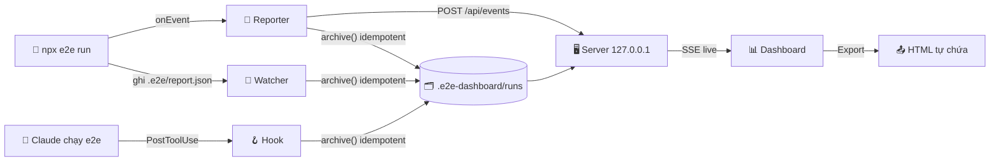

<div align="center">

# 🧪 e2e-dashboard

**Dashboard local cho [e2e](https://github.com/tester-army/e2e): theo dõi live, lưu lịch sử, debug test fail và chia sẻ report.**
**Chạy ngay trong Claude Code bằng một lệnh `/e2e-dashboard`.**


[✨ Tính năng](#-tính-năng) · [📸 Ảnh chụp](#-ảnh-chụp) · [🚀 Cài đặt](#-cài-đặt) · [⌨️ Lệnh](#️-lệnh) · [🚦 Trạng thái](#-trạng-thái--ngưỡng) · [⚙️ Cấu hình](#️-cấu-hình) · [🔒 Bảo mật](#-bảo-mật) · [🛠️ Phát triển](#️-phát-triển) · [🗺️ Roadmap](#️-roadmap)


</div>

---

## ✨ Tính năng

| | Tính năng | Mô tả |
|:-:|---|---|
| 📡 | **Theo dõi live** | Tiến độ từng test và step, biểu đồ Gantt theo làn, ước lượng thời gian còn lại (ETA) |
| 🗂️ | **Lịch sử không cần database** | Mỗi run là một thư mục file (`report.json`, `meta.json`, trace, artifact). Giữ 50 run gần nhất, run đã ghim được giữ mãi |
| 🚦 | **KPI có màu sức khoẻ** | Pass rate, run gần nhất, thời gian, token, replay cache tự chuyển 🟢 Tốt · 🟡 Cần chú ý · 🔴 Có vấn đề |
| 🔍 | **Debug test fail** | Timeline của agent (suy nghĩ, thao tác, chuyển trang), video đồng bộ theo step, screenshot lúc fail, log, trace |
| 📊 | **Biểu đồ hiện đại** | Area có gradient, donut, sparkline, stacked bar, heatmap test × run, thanh ngang test chậm nhất |
| 🧮 | **Ma trận test × target** | Thấy ngay lỗi chỉ xảy ra trên một trình duyệt hoặc thiết bị |
| 🌿 | **Git context** | Mỗi run ghi branch, commit, có thay đổi chưa commit hay không |
| 📤 | **Export HTML** | Một file tự chứa (ảnh nhúng base64, có CSP) để gửi qua chat, email hoặc đính kèm issue |
| 🌗 | **Sáng / Tối** | Tự theo hệ điều hành, có nút chuyển và nhớ lựa chọn |
| 🔗 | **Deep link** | Mỗi run và mỗi test có URL riêng (`#/run/<id>/test/<id>`) |

> [!TIP]
> **Không cài thêm gì.** Plugin chỉ cần Node (e2e vốn đã cần), không có dependency npm, không bước build, không tải CDN, nên chạy được cả khi không có mạng.

---

## 📸 Ảnh chụp

<table>
  <tr>
    <td width="50%"><b>🌙 Overview — chế độ tối + panel "Cách tính trạng thái"</b><br></td>
    <td width="50%"><b>🔍 Run detail — timeline agent, lỗi, log</b><br></td>
  </tr>
  <tr>
    <td width="50%"><b>📡 Live — Gantt theo làn, ETA</b><br></td>
    <td width="50%"><b>☀️ Overview — chế độ sáng</b><br></td>
  </tr>
</table>

---

## 🚀 Cài đặt

> [!IMPORTANT]
> Cần một project đã dùng **e2e** (có `e2e.config.ts`). e2e bản mới yêu cầu **Node ≥ 22.22.3** (hoặc ≥ 24.8).

**1️⃣ Thêm marketplace và cài plugin** (trong Claude Code):

```text
/plugin marketplace add thangvofastboy/e2e-dashboard
/plugin install e2e-dashboard@e2e-dashboard
```

**2️⃣ Mở dashboard** ở thư mục project e2e:

```text
/e2e-dashboard
```

**3️⃣ (Tuỳ chọn) Bật chế độ xem live:**

```text
/e2e-dashboard setup
```

Lệnh này copy `e2e-dashboard.reporter.mjs` (kèm `.d.mts`) vào project và thêm reporter vào `e2e.config.ts`. Output terminal của e2e vẫn giữ nguyên. Hãy commit 2 file reporter đó: trên CI (`CI=true`) reporter tự tắt, còn máy chưa cài plugin vẫn chạy test bình thường.

> [!NOTE]
> Không cài reporter vẫn có lịch sử: run do Claude chạy được lưu qua hook, run bạn tự chạy được lưu khi dashboard đang mở.

---

## ⌨️ Lệnh

| Lệnh | | Việc |
|---|:-:|---|
| `/e2e-dashboard` | 🖥️ | Bật server nền nếu chưa chạy, mở trình duyệt, in URL |
| `/e2e-dashboard setup` | 🔌 | Gắn reporter vào `e2e.config.ts` để xem live |
| `/e2e-dashboard export [runId]` | 📤 | Xuất một run (mặc định là run mới nhất) thành HTML tự chứa |
| `/e2e-dashboard status` | ℹ️ | Xem server có đang chạy không |
| `/e2e-dashboard stop` | ⏹️ | Tắt server |

> [!TIP]
> Nếu Claude Code báo trùng tên lệnh, gõ tên đầy đủ `/e2e-dashboard:e2e-dashboard`.

---

## 🚦 Trạng thái & ngưỡng

Mỗi thẻ KPI tự đổi màu theo ngưỡng. Bấm vào chip trạng thái để mở panel **"Cách tính trạng thái"**: ô ứng với giá trị hiện tại được viền màu và gắn nhãn *hiện tại*.

| Chỉ số |  |  |  |
|---|---|---|---|
| 🎯 Pass rate | ≥ 95% | 80–95% | < 80% |
| ✅ Run gần nhất | passed | flaky / blocked | failed / interrupted / error |
| ⏱️ Thời gian chạy | ≤ +10% so với TB 10 run | +10% → +30% | > +30% |
| 🪙 Token / run | ≤ +10% so với TB 10 run | +10% → +30% | > +30% |
| ♻️ Replay cache | ≥ 80% | 50–80% | < 50% |

Màu không bao giờ đứng một mình: mọi trạng thái đều có icon kèm chữ, để người mù màu và bản in vẫn đọc được.

---

## ⚙️ Cấu hình

Mọi thứ đều tuỳ chọn. Tạo `.e2e-dashboard/config.json` trong project e2e:

```jsonc
{
  "output": ".e2e",        // thư mục output của e2e (nếu bạn đổi --output)
  "retention": 50,         // số run giữ lại (run đã ghim không tính)
  "port": 4477,            // port ưu tiên; bận thì tự lấy port kế tiếp
  "thresholds": {          // ghi đè ngưỡng trạng thái (tỉ lệ 0–1)
    "passRate": { "good": 0.98, "warn": 0.9 },
    "duration": { "good": 0.05, "warn": 0.2 }
  }
}
```

<details>
<summary>🗂️ <b>Dữ liệu được lưu ở đâu?</b></summary>

```text
<project>/.e2e-dashboard/
├── .gitignore              ← "*": cả thư mục tự bị git bỏ qua
├── config.json             ← (tuỳ chọn) cấu hình ở trên
├── server.json             ← port + token khi server đang chạy (quyền 0600)
├── server.log
├── exports/run-<id>.html   ← file export
└── runs/<thời-điểm>_<runId>/
    ├── report.json         ← bản copy nguyên văn report của e2e
    ├── meta.json           ← tóm tắt: status, số test, token, git, ghim/baseline
    ├── traces/<resultId>.md
    └── artifacts/…         ← video / screenshot / log của test không pass
```

Muốn sao lưu thì copy thư mục, muốn xoá lịch sử thì xoá thư mục.
</details>

<details>
<summary>🧭 <b>Cách hoạt động</b></summary>



Ba nguồn (reporter, watcher, hook) cùng gọi một hàm `archive()`. Hàm này lấy `run.id` làm khoá và ghi qua thư mục tạm rồi `rename`, nên một run chỉ được lưu đúng một lần.
</details>

---

## 🔒 Bảo mật

| | Biện pháp |
|:-:|---|
| 🏠 | Server chỉ nghe `127.0.0.1` và kiểm tra header `Host` (chống DNS rebinding) |
| 🔑 | Mọi request cần token: cookie `HttpOnly; SameSite=Strict` riêng theo từng port. Request POST còn phải có `Origin` khớp |
| 🧱 | Không bao giờ đi theo symlink do repo gài sẵn khi lưu, export hay phục vụ file |
| 🧼 | Mọi nội dung lấy từ report (lỗi, log, reasoning) đều được escape. Link Markdown chỉ nhận `http(s)` |
| 📄 | Artifact HTML/SVG được trả về dạng text kèm `CSP: sandbox`. File export có CSP riêng dựa trên hash |
| 🤐 | Reporter tự tắt trên CI và không bao giờ throw hay làm hỏng run của e2e |

---

## 🛠️ Phát triển

```bash
npm test                   # node --test — 135 test, không dependency
node test/seed-demo.mjs    # tạo project demo với 12 run để xem UI
```

<details>
<summary>📁 <b>Cấu trúc repo</b></summary>

| Thư mục | Vai trò |
|---|---|
| `reporter/` | Reporter tự chứa + `archive()` + retention (được copy vào project người dùng) |
| `server/` | HTTP server, store, live state, watcher, export |
| `bin/` | CLI `dashboard.mjs`, hook `archive.mjs` |
| `ui/` | ES module thuần (gộp bằng `ui/bundle.mjs`), icon SVG, chart SVG |
| `commands/`, `hooks/` | Lệnh `/e2e-dashboard` và hook PostToolUse của plugin |
| `docs/superpowers/` | Spec và plan thiết kế |

</details>

---

## 🗺️ Roadmap

- [x] **M1a — Thu thập & xem:** lịch sử, live, Overview / Runs / Run detail / Live / Tests, export HTML, giao diện mới
- [ ] **M1b — Điều khiển & AI:** chạy và rerun test (chọn test fail) từ dashboard, nút ✨ *Phân tích lỗi* / *Phân tích run* qua `claude -p`
- [ ] **M2 — Phân tích:** flaky, so sánh 2 run, nhóm lỗi, chi phí & cache, visual diff, bản đồ route, so sánh branch, nhiều project, health score
- [ ] **M3 — Tích hợp:** gửi issue Linear (chống trùng), digest tuần, status line, thông báo desktop, đề xuất chuyển agent step thành locator

<div align="center">

---

Làm cho [e2e](https://github.com/tester-army/e2e) bởi **thangvofastboy** · Xây dựng cùng [Claude Code](https://claude.com/claude-code) 🤖

</div>
