<div align="center">

# 🧪 e2e-dashboard

**Dashboard local cho [e2e](https://github.com/tester-army/e2e): theo dõi live, lưu lịch sử, debug test fail và chia sẻ report.**
**Chạy ngay trong Claude Code bằng một lệnh `/e2e-dashboard`.**


[✨ Tính năng](#-tính-năng) · [📸 Ảnh chụp](#-ảnh-chụp) · [🚀 Cài đặt](#-cài-đặt) · [⌨️ Lệnh](#️-lệnh) · [✨ AI](#-phân-tích-bằng-ai) · [📊 Phân tích](#-phân-tích-m2) · [🔗 Tích hợp](#-tích-hợp-m3) · [🚦 Trạng thái](#-trạng-thái--ngưỡng) · [⚙️ Cấu hình](#️-cấu-hình) · [🔄 Cập nhật](#-cập-nhật--phát-hành) · [🔒 Bảo mật](#-bảo-mật) · [🛠️ Phát triển](#️-phát-triển) · [🗺️ Roadmap](#️-roadmap)

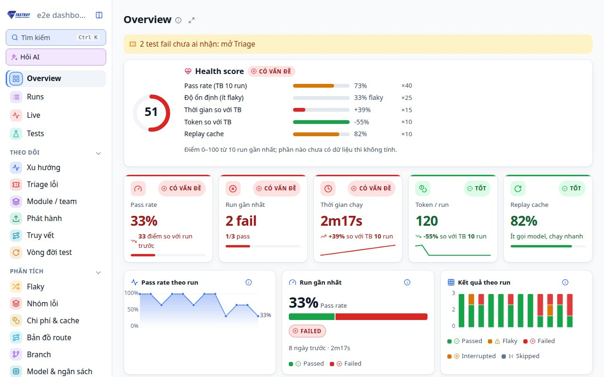

</div>

---

## ✨ Tính năng

| | Tính năng | Mô tả |
|:-:|---|---|
| 📡 | **Theo dõi live** | Tiến độ từng test và step, biểu đồ Gantt theo làn, ước lượng thời gian còn lại (ETA) |
| 🗂️ | **Lịch sử không cần database** | Mỗi run là một thư mục file (`report.json`, `meta.json`, trace, artifact). Giữ 50 run gần nhất, run đã ghim được giữ mãi |
| 🚦 | **KPI có màu sức khoẻ** | Pass rate, run gần nhất, thời gian, token, replay cache tự chuyển 🟢 Tốt · 🟡 Cần chú ý · 🔴 Có vấn đề |
| ▶️ | **Chạy & chạy lại test** | Chọn test (hoặc *Chọn tất cả fail*) → hộp thoại Run: target, agent, retries, repeat-each, `--no-cache` → xem live ngay; run mới ghi lại là chạy lại của run nào |
| ✨ | **Phân tích bằng AI** | Nút *Phân tích lỗi* / *Phân tích run* gọi `claude -p` (không cần API key): phân loại lỗi app / test / flaky / môi trường, bằng chứng `file:line`, gợi ý sửa, hỏi tiếp |
| 🔍 | **Debug test fail** | Timeline của agent (suy nghĩ, thao tác, chuyển trang), video đồng bộ theo step, screenshot lúc fail, log, trace |
| 📊 | **Biểu đồ hiện đại** | Area có gradient, donut, sparkline, stacked bar, heatmap test × run, thanh ngang test chậm nhất |
| 🧮 | **Ma trận test × target** | Thấy ngay lỗi chỉ xảy ra trên một trình duyệt hoặc thiết bị |
| 🌿 | **Git context** | Mỗi run ghi branch, commit, có thay đổi chưa commit hay không |
| 📤 | **Export HTML** | Một file tự chứa (ảnh nhúng base64, có CSP) để gửi qua chat, email hoặc đính kèm issue |
| 🌗 | **Sáng / Tối** | Tự theo hệ điều hành, có nút chuyển và nhớ lựa chọn |
| 🔗 | **Deep link** | Mỗi run và mỗi test có URL riêng (`#/run/<id>/test/<id>`) |
| 🔄 | **Tự cập nhật** | `/e2e-dashboard update` lấy tag mới nhất rồi tự `/reload-plugins` |
| ❤️ | **Health score** | Một điểm 0–100 cho cả suite: pass rate, độ ổn định, thời gian, token, replay cache |
| 🔀 | **Flaky** | Test pass nhờ retry hoặc đổi kết quả giữa các run (nặng hơn khi cùng commit), nút *Chạy ×5* để xác nhận |
| ⚖️ | **So sánh 2 run** | Mới fail / đã sửa / vẫn fail / thành flaky, chênh thời gian, token, chi phí; kèm **visual diff** screenshot |
| 🧩 | **Nhóm lỗi** | Gom lỗi cùng mã và cùng dạng thông báo: sửa một chỗ, hết nhiều test |
| 🪙 | **Chi phí & cache** | Token, chi phí ước tính, ngân sách, kết quả replay cache và lý do miss, step chậm nhất |
| 🗺️ | **Bản đồ route** | Các trang test đi qua và nơi hay fail |
| 🌿 | **So sánh branch** | Test nào chỉ hỏng ở một branch |
| 📁 | **Nhiều project** | Mọi project đã mở dashboard trên máy, kèm health score và nút mở |
| 🎫 | **Gửi Linear** | Tạo issue từ test fail, **chống trùng** bằng fingerprint; không có API key thì nhờ Claude + Linear MCP |
| 📰 | **Digest tuần** | Tóm tắt Markdown để dán vào Slack/email |
| 📟 | **Status line** | Kết quả run mới nhất (hoặc tiến độ) ngay trong Claude Code |
| 🔔 | **Thông báo desktop** | Báo khi run fail (hoặc mọi run) |
| 🔎 | **Tìm kiếm Ctrl K** | Test, mã lỗi, URL, branch, commit, run id trong 50 run gần nhất, không phân biệt dấu |
| 🔒 | **Cách ly test flaky** | Bỏ test khỏi các run có thời hạn, lệnh `--grep-invert` cho CI, digest nhắc test quá hạn |
| 🧬 | **Tìm commit gây lỗi** | Lần pass gần nhất → lần fail đầu tiên, sinh sẵn lệnh `git bisect run` cho đúng test đó |
| ⚡ | **Bất thường** | Test chậm hoặc tốn token hơn hẳn lịch sử của chính nó (TB + 2σ), có thông báo desktop |
| 🧠 | **Model & ngân sách** | So sánh các model theo `step.model`: tỉ lệ pass, token, thời gian, $ mỗi step, ngân sách theo model |
| ✅ | **Lint câu lệnh agent** | Thiếu bước kiểm tra (cache không được ghi), gộp nhiều mục tiêu, mơ hồ, quá dài, tốn model call |
| 👥 | **CODEOWNERS** | Owner của test hiện ở Run detail, issue Linear và digest |
| ☁️ | **Nhập từ CI** | `report.json` hoặc artifact GitHub Actions (`gh run download`) vào lịch sử, nguồn `ci` |
| 🤝 | **Thư mục team** | `share push/pull`: đẩy và kéo run qua một thư mục chung (đồng bộ / mạng) |
| 💬 | **Comment PR** | Đăng kết quả so sánh 2 run lên PR đang mở của branch qua `gh` |
| 📄 | **Trang riêng từng test** | Pass rate, biểu đồ thời gian/token, các lần fail, step gần nhất, ảnh fail theo thời gian, owner, cách ly |
| 🐞 | **Lỗi phía app** | Lỗi console và request 4xx/5xx từ `appLog`, gom theo dạng, commit đầu tiên xuất hiện |
| 🎯 | **Test bị ảnh hưởng** | Từ `git diff` so với `main`: file test, route đã đi qua, tên test → một nút chạy |
| 💬 | **Hỏi AI tự do** | Hỏi về cả bộ test, Claude nhận tóm tắt 30 run gần nhất |
| ⏱️ | **Setup & hook** | Thời gian setup, beforeEach, afterEach so với thân test |
| 👀 | **Watch & lịch chạy** | Lưu file test là chạy lại; chạy hằng ngày theo giờ đặt sẵn |
| 📣 | **Webhook Slack/Discord** | Run fail, bất thường, digest tuần |
| ✅ | **Trạng thái commit GitHub** | Gắn ✓/✗ của run lên commit qua `gh` |
| 🧭 | **Explore → test** | Xem goal/bước/finding của `e2e explore`, nhờ AI viết nháp test |
| 💾 | **Dung lượng** | Xem dung lượng theo loại, xoá video cũ, xoá run, giữ run fail lâu hơn |
| ⌨️ | **Phím tắt & bộ lọc trên URL** | `?`, `g`+phím, `/`, `j`/`k`/`r`/`a`/`l` ở trang run; link chia sẻ mở đúng bộ lọc |
| 🎯 | **Agent step → locator** | Step `agent.act` replay ổn định được dựng thành code `screen.getByRole(...)` từ cache của e2e |

> [!TIP]
> **Không cài thêm gì.** Plugin chỉ cần Node (e2e vốn đã cần), không có dependency npm, không bước build, không tải CDN, nên chạy được cả khi không có mạng.

---

## 📸 Ảnh chụp

<table>
  <tr>
    <td width="50%"><b>🌙 Overview — chế độ tối + panel "Cách tính trạng thái"</b><br>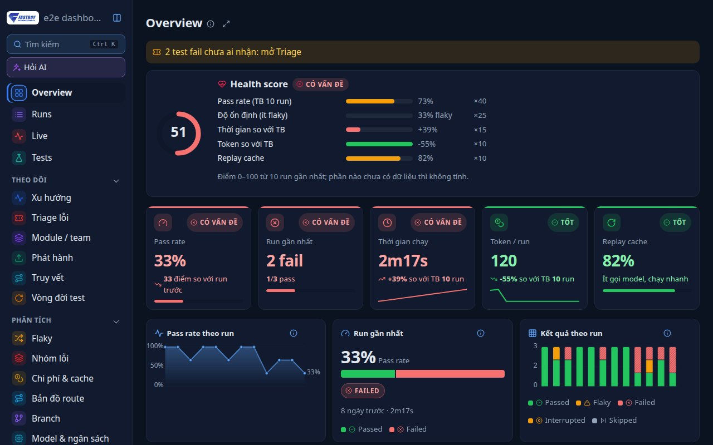</td>
    <td width="50%"><b>🔍 Run detail — timeline agent, lỗi, log</b><br>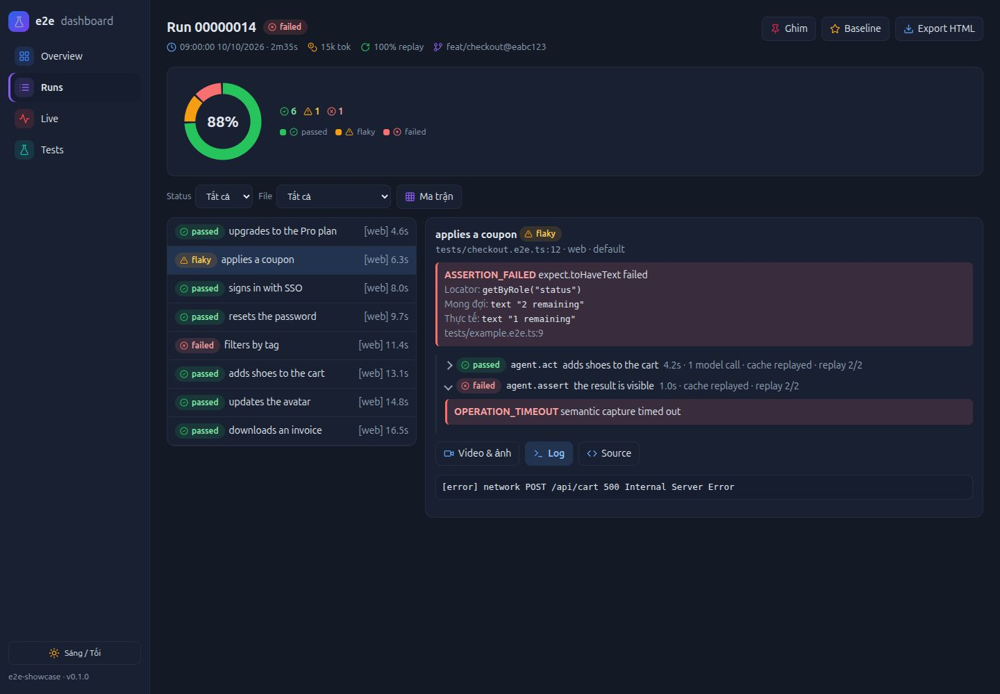</td>
  </tr>
  <tr>
    <td width="50%"><b>📡 Live — Gantt theo làn, ETA</b><br>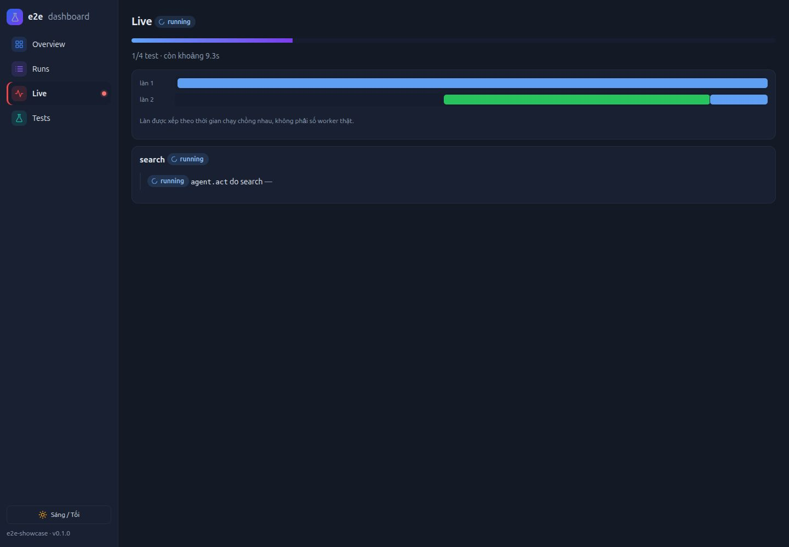</td>
    <td width="50%"><b>✨ Phân tích lỗi bằng AI (claude -p)</b><br>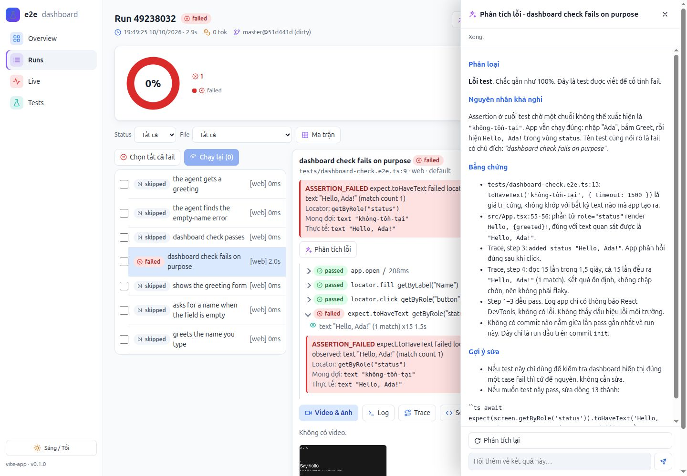</td>
  </tr>
  <tr>
    <td width="50%"><b>⚖️ So sánh 2 run + visual diff</b><br>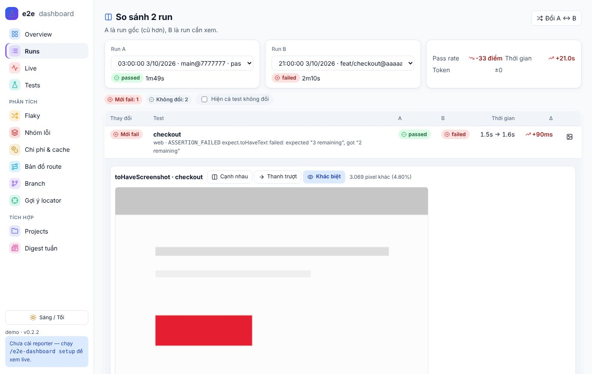</td>
    <td width="50%"><b>🔀 Flaky</b><br>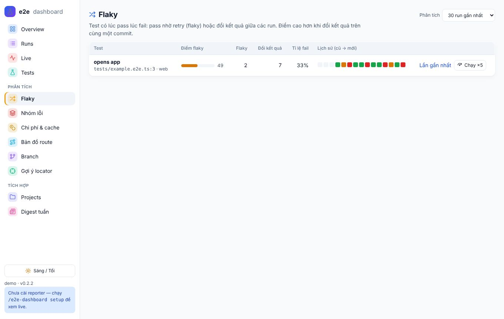</td>
  </tr>
  <tr>
    <td width="50%"><b>🗺️ Bản đồ route</b><br>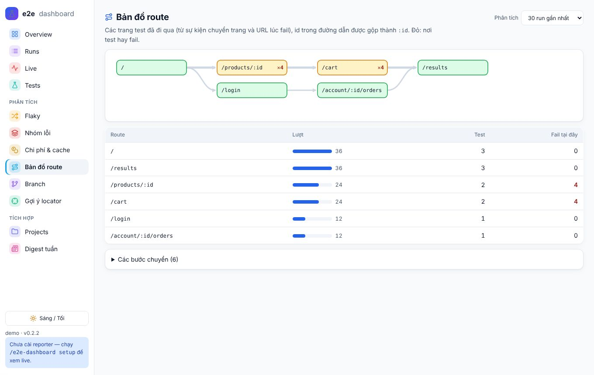</td>
    <td width="50%"><b>🎯 Gợi ý locator từ replay cache</b><br>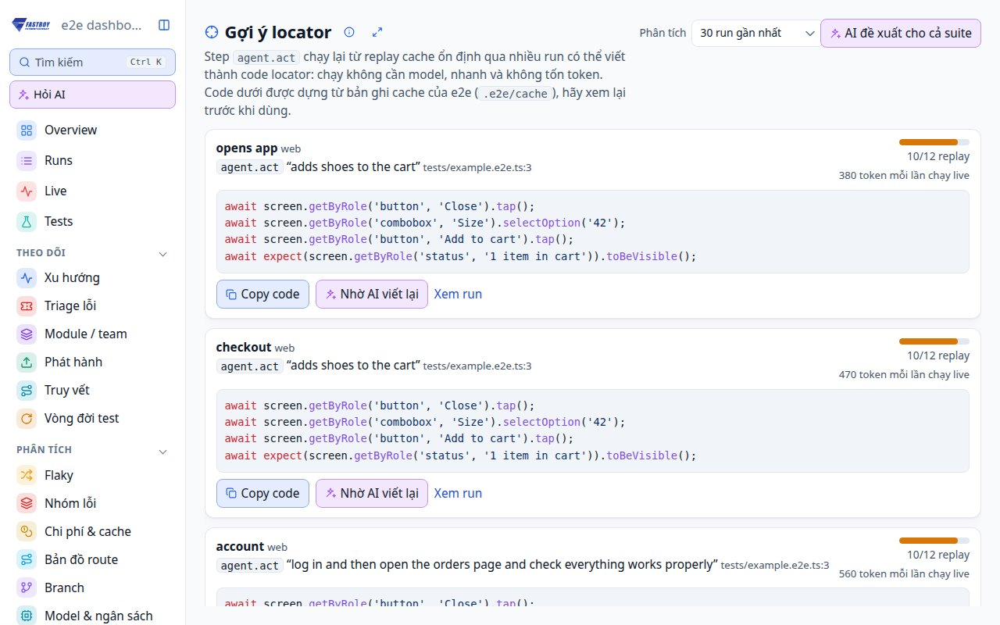</td>
  </tr>
  <tr>
    <td width="50%"><b>📄 Trang riêng từng test</b><br>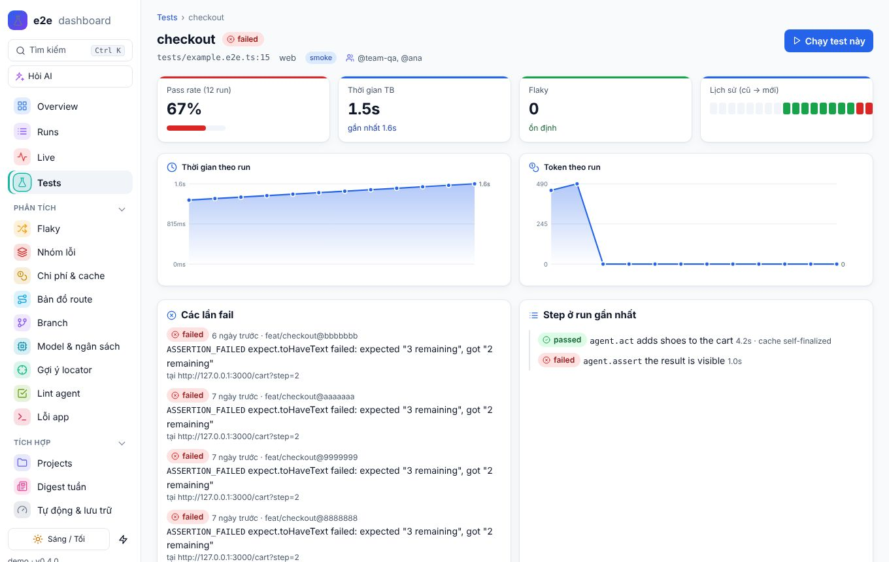</td>
    <td width="50%"></td>
  </tr>
</table>

---

## 🚀 Cài đặt

> [!IMPORTANT]
> Cần một project đã dùng **e2e** (có `e2e.config.ts`). e2e bản mới yêu cầu **Node ≥ 22.22.3** (hoặc ≥ 24.8).

**1️⃣ Thêm marketplace và cài plugin** (trong Claude Code):

```text
/plugin marketplace add thangvofastboy/e2e-dashboard
/plugin install e2e-dashboard@e2e-dashboard
/reload-plugins
```

**2️⃣ Mở dashboard** ở thư mục project e2e:

```text
/e2e-dashboard
```

**3️⃣ (Tuỳ chọn) Bật chế độ xem live:**

```text
/e2e-dashboard setup
```

Lệnh này copy `e2e-dashboard.reporter.mjs` (kèm `.d.mts`) vào project và thêm reporter vào `e2e.config.ts`. Output terminal của e2e vẫn giữ nguyên. Hãy commit 2 file reporter đó: trên CI (`CI=true`) reporter tự tắt, còn máy chưa cài plugin vẫn chạy test bình thường.

> [!NOTE]
> Không cài reporter vẫn có lịch sử: run do Claude chạy được lưu qua hook, run bạn tự chạy được lưu khi dashboard đang mở.

---

## ⌨️ Lệnh

| Lệnh | | Việc |
|---|:-:|---|
| `/e2e-dashboard` | 🖥️ | Bật server nền nếu chưa chạy, mở trình duyệt, in URL |
| `/e2e-dashboard setup` | 🔌 | Gắn reporter vào `e2e.config.ts` để xem live |
| `/e2e-dashboard export [runId]` | 📤 | Xuất một run (mặc định là run mới nhất) thành HTML tự chứa |
| `/e2e-dashboard status` | ℹ️ | Xem server có đang chạy không |
| `/e2e-dashboard digest [ngày]` | 📰 | In digest Markdown (mặc định 7 ngày), lưu vào `.e2e-dashboard/digests/` |
| `/e2e-dashboard projects` | 📁 | Liệt kê các project đã mở dashboard, health score, URL nếu đang chạy |
| `/e2e-dashboard statusline [install]` | 📟 | Hướng dẫn / cài status line cho Claude Code |
| `/e2e-dashboard quarantine` | 🔒 | Test đang cách ly và lệnh `npx e2e run --grep-invert …` cho CI |
| `/e2e-dashboard import <report.json\|thư mục>` | ☁️ | Nhập report (vd. tải từ CI) vào lịch sử; `import --gh <run id> [--name <artifact>]` tải qua `gh` |
| `/e2e-dashboard share push\|pull [dir]` | 🤝 | Đẩy run của bạn / kéo run của team qua thư mục chung |
| `/e2e-dashboard version` | 🏷️ | Version đang cài và có bản mới không (chạy local, không tốn token) |
| `/e2e-dashboard update` | 🔄 | Cập nhật lên tag mới nhất rồi tự `/reload-plugins` |
| `/e2e-dashboard stop` | ⏹️ | Tắt server |

> [!TIP]
> Tất cả lệnh trên chạy local, không tốn token. Nếu cần Claude tự sửa `e2e.config.ts` (config có dạng lạ), dùng tên đầy đủ `/e2e-dashboard:e2e-dashboard setup`: lệnh này nhờ Claude chèn reporter giúp.

---

## ✨ Phân tích bằng AI

Trên trang run: **✨ Phân tích run** (tóm tắt, gom nhóm lỗi, ưu tiên xử lý) hoặc, ở test fail, **✨ Phân tích lỗi**. Kết quả chạy dần trong panel bên phải; *Phân tích lại* bỏ qua cache; ô *Hỏi thêm* tiếp tục cùng phiên (`--resume`).

| | |
|:-:|---|
| 🧠 | Dùng Claude Code CLI bạn đang đăng nhập (`claude -p`), **không cần API key** |
| 🧾 | Prompt gồm lỗi, timeline step, log app, đường dẫn trace và **commit giữa lần pass gần nhất với run này** |
| 🗃️ | Kết quả cache theo run (`runs/<run>/ai/`), xoá theo retention, **nhúng vào file export** |
| 🛡️ | Sandbox: `--restricted`, chỉ có `Read/Grep/Glob`, không MCP, từ chối mọi quyền khác; text của app được rào bằng thẻ có nonce |
| ⏱️ | Tối đa 2 phân tích cùng lúc, timeout 5 phút, đóng panel là dừng |
| 🔀 | **Vì sao flaky?** ở trang Flaky: Claude đọc lịch sử pass/fail theo commit, cache, timing và code test, tách flaky thật khỏi regression |
| 🎯 | **Chuyển thành locator** trên step `agent.act`: Claude đọc test và bản ghi cache, đề xuất code locator thay cho bước agent |

---

## 📊 Phân tích (M2)

Các trang ở nhóm **Phân tích** trên sidebar; mỗi trang chọn được số run gần nhất để phân tích (10–100).

| Trang | Cách tính |
|---|---|
| ❤️ **Health score** (Overview) | Pass rate TB 10 run ×40, độ ổn định (ít flaky) ×25, thời gian so với TB ×15, token so với TB ×10, replay cache ×10; phần chưa có dữ liệu không tính |
| 🔀 **Flaky** | Điểm = tỉ lệ run flaky + tỉ lệ lần đổi kết quả, cộng thêm khi đổi kết quả trên **cùng commit**. Hỏng một lần sau commit mới là regression, không phải flaky |
| ⚖️ **So sánh 2 run** | Chọn 2 run ở trang Runs, hoặc nút *So với baseline / run trước* ở Run detail. Nút 🖼️ trên mỗi dòng mở visual diff |
| 🖼️ **Visual diff** | Cạnh nhau, thanh trượt, hoặc *Khác biệt* (so từng pixel bằng canvas, tô đỏ chỗ khác, % pixel khác). Tự nhận bộ ảnh `-expected / -actual / -diff` của `toHaveScreenshot` |
| 🧩 **Nhóm lỗi** | Chữ ký = mã lỗi + thông báo đã bỏ số, chuỗi trong ngoặc, id, URL + locator. Run detail cũng có panel nhóm lỗi |
| 🪙 **Chi phí & cache** | `usage.estimatedCostUsd` của report, hoặc ước tính theo `"pricing"`; cảnh báo khi vượt `"budget"` |
| 🗺️ **Bản đồ route** | Từ sự kiện navigation, `step.screen.location` và URL lúc fail; id trong path gộp thành `:id` |
| 🌿 **Branch** | Chỉ số 10 run gần nhất mỗi branch, pass rate từng test trên A so với B |
| 🎯 **Gợi ý locator** | Step `agent.act` replay từ cache ở ≥ 3 run: đọc `.e2e/cache/<entry>.json` (trace-1) và dựng code `screen.getByRole(...).tap()`, `.fill()`, `.selectOption()`, `app.open()`… kèm một `expect` |

> [!TIP]
> Muốn visual diff giữa hai run kể cả khi test pass, bật `"screenshots": "all"`: run pass cũng giữ screenshot (không giữ video).

---

## 🔗 Tích hợp (M3)

**🎫 Linear.** Ở test fail bấm **Gửi Linear**. Nội dung issue gồm lỗi, step fail, URL, commit kể từ lần pass, phân tích AI đã lưu, và dòng `fingerprint: e2ed-…` (tên test + dạng lỗi).

- Có `LINEAR_API_KEY` (và `LINEAR_TEAM`, vd. `ENG`, khi tài khoản có nhiều team): server tìm issue chứa fingerprint trước. Đang mở → báo trùng, nút *Thêm comment run này*; đã đóng → tạo issue mới ghi "Tái phát của …"; chưa có → tạo mới.
- Không có key: **Copy cho Claude** tạo prompt để Claude Code dùng Linear MCP làm đúng các bước trên.
- Key chỉ đọc từ biến môi trường hoặc `~/.e2e-dashboard/config.json` → `"linear": { "apiKey", "team" }`, **không bao giờ** từ repo.

**📰 Digest tuần.** Trang *Digest tuần* hoặc `/e2e-dashboard digest`: số run, pass rate so với tuần trước, token, replay cache, health score, test mới fail, flaky, nhóm lỗi, step chậm nhất. Muốn tự động hằng tuần: tạo Routine trong Claude Code chạy `/e2e-dashboard digest`.

**📟 Status line.** `/e2e-dashboard statusline install` copy script vào `~/.e2e-dashboard/statusline.mjs` và đặt `statusLine` trong `~/.claude/settings.json` (không ghi đè status line có sẵn). Hiện `🧪 e2e ✓ 42/42 · 97% (10 run) · 5p trước`, hoặc `▶ e2e 3/9` khi đang chạy. Chỉ đọc file, không gọi mạng, im lặng ngoài project e2e.

**🔔 Thông báo desktop.** Khi dashboard đang chạy và một run kết thúc: `osascript` (macOS), `notify-send` (Linux), balloon PowerShell (Windows). Mặc định chỉ báo run fail/flaky; đổi bằng `"notify": "all" | "failures" | "off"`.

**🔒 Cách ly test flaky.** Ở trang Flaky bấm *Cách ly* (14 ngày, kèm lý do). Hộp thoại Run có ô *Bỏ qua test đang cách ly*; `/e2e-dashboard quarantine` in lệnh `--grep-invert` để dùng trong CI. Hết hạn mà chưa gỡ thì digest nhắc.

**🧬 Tìm commit gây lỗi.** Ở test fail bấm *Tìm commit gây lỗi*: dashboard tìm lần pass gần nhất và lần fail đầu tiên, rồi sinh `git bisect start <bad> <good>` + `git bisect run npx e2e run <file:line> --no-cache --retries 0`. Dashboard không tự checkout: bạn chạy lệnh trong terminal.

**☁️ CI và 🤝 team.** Reporter tự tắt trên CI; để xem lịch sử CI, tải artifact chứa `.e2e/report.json` (*Nhập từ GitHub Actions* ở trang Runs, hoặc `import --gh <run id>`). Team dùng chung một thư mục (`"share": { "dir": "…" }` trong `~/.e2e-dashboard/config.json`): `share push` đẩy run của bạn, `share pull` kéo run của người khác (kiểm tra id, schema, không theo symlink; hiện với nguồn `shared`).

**💬 Comment PR.** Ở trang So sánh 2 run bấm *Đăng lên PR*: xem trước Markdown, rồi đăng qua `gh pr comment` lên PR đang mở của branch run B (cần `gh auth login`).

**📄 Trang test.** Bấm tên test ở Tests, Flaky, Tìm kiếm hay trang Run để xem toàn bộ lịch sử của test đó.

**🎯 Test bị ảnh hưởng.** Ở trang Tests, nhập nhánh gốc (mặc định `main`) rồi bấm *Tìm*: dashboard đọc `git diff` (đã commit, chưa commit, file mới), ghép với file test, các route test đã đi qua và từ khoá trong tên test, rồi cho chạy đúng những test đó.

**👀 Watch, lịch chạy, webhook.** Trang *Tự động & lưu trữ*: bật watch (lưu `*.e2e.ts` là chạy lại file đó); lịch chạy `"schedule": { "daily": ["02:00"], "tests": [] }` trong config; webhook đặt ở `~/.e2e-dashboard/config.json` → `"webhooks": [{ "url": "https://hooks.slack.com/…", "events": ["run-failed", "digest"] }]` (hoặc `E2E_DASHBOARD_WEBHOOK`), digest tuần gửi bằng `/e2e-dashboard digest --send`. Mọi thứ chỉ chạy khi dashboard đang mở và bỏ qua test đang cách ly.

**📁 Nhiều project.** Mỗi lần mở dashboard, project được ghi vào `~/.e2e-dashboard/projects.json`. Trang *Projects* hiện mọi project, run gần nhất, health score, nút mở (nếu server đang chạy) hoặc lệnh để mở.

---

## 🚦 Trạng thái & ngưỡng

Mỗi thẻ KPI tự đổi màu theo ngưỡng. Bấm vào chip trạng thái để mở panel **"Cách tính trạng thái"**: ô ứng với giá trị hiện tại được viền màu và gắn nhãn *hiện tại*.

| Chỉ số |  |  |  |
|---|---|---|---|
| 🎯 Pass rate | ≥ 95% | 80–95% | < 80% |
| ✅ Run gần nhất | passed | flaky / blocked | failed / interrupted / error |
| ⏱️ Thời gian chạy | ≤ +10% so với TB 10 run | +10% → +30% | > +30% |
| 🪙 Token / run | ≤ +10% so với TB 10 run | +10% → +30% | > +30% |
| ♻️ Replay cache | ≥ 80% | 50–80% | < 50% |

Màu không bao giờ đứng một mình: mọi trạng thái đều có icon kèm chữ, để người mù màu và bản in vẫn đọc được.

---

## ⚙️ Cấu hình

Mọi thứ đều tuỳ chọn. Tạo `.e2e-dashboard/config.json` trong project e2e:

```jsonc
{
  "output": ".e2e",        // thư mục output của e2e (nếu bạn đổi --output)
  "retention": 50,         // số run giữ lại (run đã ghim không tính)
  "port": 4477,            // port ưu tiên; bận thì tự lấy port kế tiếp
  "ai": { "model": "sonnet", "language": "vi" },  // model và ngôn ngữ trả lời của AI
  "thresholds": {          // ghi đè ngưỡng trạng thái (tỉ lệ 0–1)
    "passRate": { "good": 0.98, "warn": 0.9 },
    "duration": { "good": 0.05, "warn": 0.2 }
  },
  "screenshots": "all",    // giữ screenshot cả của test pass (mốc cho visual diff)
  "pricing": { "inputPerMTok": 3, "outputPerMTok": 15 },  // ước tính chi phí khi report không có
  "budget": { "tokensPerRun": 200000, "costPerRun": 0.5 }, // cảnh báo vượt ngân sách
  "notify": "failures",    // "all" | "failures" | "off"
  "cacheDir": ".e2e/cache", // nếu đổi thư mục replay cache của e2e
  "linear": { "team": "ENG" }, // gợi ý team; API key KHÔNG đặt ở đây
  "budget": { "perModel": { "anthropic/claude-sonnet-4.5": 5 } } // (gộp với budget ở trên) USD theo model
}
```

<details>
<summary>🗂️ <b>Dữ liệu được lưu ở đâu?</b></summary>

```text
<project>/.e2e-dashboard/
├── .gitignore              ← "*": cả thư mục tự bị git bỏ qua
├── config.json             ← (tuỳ chọn) cấu hình ở trên
├── server.json             ← port + token khi server đang chạy (quyền 0600)
├── server.log
├── live.json               ← tiến độ run hiện tại (cho status line)
├── issues.json             ← fingerprint → issue Linear đã gửi
├── quarantine.json         ← test đang cách ly
├── digests/<ngày>.md       ← digest đã in
├── exports/run-<id>.html   ← file export
└── runs/<thời-điểm>_<runId>/
    ├── report.json         ← bản copy nguyên văn report của e2e
    ├── meta.json           ← tóm tắt: status, số test, token, git, ghim/baseline
    ├── traces/<resultId>.md
    └── artifacts/…         ← video / screenshot / log của test không pass
```

Muốn sao lưu thì copy thư mục, muốn xoá lịch sử thì xoá thư mục.
</details>

<details>
<summary>🧭 <b>Cách hoạt động</b></summary>

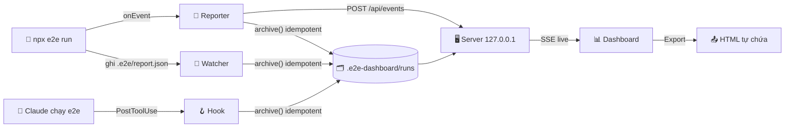

Ba nguồn (reporter, watcher, hook) cùng gọi một hàm `archive()`. Hàm này lấy `run.id` làm khoá và ghi qua thư mục tạm rồi `rename`, nên một run chỉ được lưu đúng một lần.
</details>

---

## 🔄 Cập nhật & phát hành

**Người dùng:** gõ `/e2e-dashboard version` để xem có bản mới, `/e2e-dashboard update` để cập nhật. Lệnh chạy `claude plugin marketplace update` + `claude plugin update`, rồi tự gọi `/reload-plugins`: không cần khởi động lại Claude Code.

**Người phát hành:** mỗi lần merge vào `main` là một bản phát hành có tag `vX.Y.Z`.

```bash
npm run release -- minor          # patch | minor | major | X.Y.Z
npm run release -- minor --push   # đẩy luôn main + tag lên GitHub
```

Script kiểm tra (`npm test`, `claude plugin validate`, `claude plugin test`), nâng version ở `plugin.json`, `package.json`, reporter, **ghim `marketplace.json` vào tag mới**, commit và tạo tag. Workflow `.github/workflows/tag-on-main.yml` tự gắn tag cho version trên `main` nếu còn thiếu (ví dụ khi merge PR trên GitHub).

---

## 🔒 Bảo mật

| | Biện pháp |
|:-:|---|
| 🏠 | Server chỉ nghe `127.0.0.1` và kiểm tra header `Host` (chống DNS rebinding) |
| 🔑 | Mọi request cần token: cookie `HttpOnly; SameSite=Strict` riêng theo từng port. Request POST còn phải có `Origin` khớp |
| 🧱 | Không bao giờ đi theo symlink do repo gài sẵn khi lưu, export hay phục vụ file |
| 🧼 | Mọi nội dung lấy từ report (lỗi, log, reasoning) đều được escape. Link Markdown chỉ nhận `http(s)` |
| 📄 | Artifact HTML/SVG được trả về dạng text kèm `CSP: sandbox`. File export có CSP riêng dựa trên hash |
| 🤐 | Reporter tự tắt trên CI và không bao giờ throw hay làm hỏng run của e2e |
| ▶️ | Lệnh chạy test được dựng từ danh sách tham số đã kiểm tra (`file:line`, tên target/agent, số nguyên có giới hạn), không qua shell, mỗi project một run |
| ✨ | `claude -p` chạy sandbox: không shell, không MCP, chỉ đọc file; dữ liệu report được rào và đánh dấu không tin cậy |
| 🎫 | API key Linear chỉ lấy từ môi trường hoặc `~/.e2e-dashboard/`, không từ repo; Linear chỉ được gọi khi bạn bấm gửi. Nội dung report vào issue được bỏ HTML và không giả được dòng fingerprint |
| 💬 | `gh` và `git` luôn chạy bằng argv, nội dung comment qua stdin; tên branch, run id, artifact đều được kiểm tra trước |
| 📣 | URL webhook chỉ lấy từ `~/.e2e-dashboard/config.json` hoặc biến môi trường, chỉ `https`: repo clone về không thể gửi dữ liệu test tới địa chỉ nó chọn |
| 🎯 | `git diff` chỉ nhận tên nhánh hợp lệ (không bắt đầu bằng `-`); lịch chạy/watch dùng chung runner đã kiểm tra tham số |
| 🤝 | Run kéo từ thư mục team chỉ là dữ liệu: kiểm tra id khớp tên thư mục, schema `report-1`, bỏ symlink, bỏ kết quả AI của người khác |
| 🔔 | Thông báo desktop truyền tiêu đề/nội dung qua argv hoặc biến môi trường, không qua shell |
| 🎯 | Bản ghi replay cache chỉ đọc khi tên là hash 64 hex, nằm trong project, không qua symlink, ≤ 1 MiB |

---

## 🛠️ Phát triển

```bash
npm test                   # node --test — 249 test, không dependency
claude plugin test .       # test của mod (update / version)
node test/seed-demo.mjs    # project demo 12 run: flaky, 2 branch, route, cache, ảnh visual diff
```

<details>
<summary>📁 <b>Cấu trúc repo</b></summary>

| Thư mục | Vai trò |
|---|---|
| `reporter/` | Reporter tự chứa + `archive()` + retention (được copy vào project người dùng) |
| `server/` | HTTP server, store, live state, watcher, export |
| `bin/` | CLI `dashboard.mjs`, hook `archive.mjs` |
| `hooks/` | Hook PostToolUse + mod `register.ts` (`update` / `version`) |
| `scripts/` | `release.mjs` — nâng version, ghim marketplace, tạo tag |
| `ui/` | ES module thuần (gộp bằng `ui/bundle.mjs`), icon SVG, chart SVG |
| `commands/` | Lệnh `/e2e-dashboard` |
| `docs/superpowers/` | Spec và plan thiết kế |

</details>

---

## 🗺️ Roadmap

- [x] **M1a — Thu thập & xem:** lịch sử, live, Overview / Runs / Run detail / Live / Tests, export HTML, giao diện mới
- [x] **M1b — Điều khiển & AI:** chạy và rerun test (chọn test fail) từ dashboard, nút ✨ *Phân tích lỗi* / *Phân tích run* qua `claude -p`, tự cập nhật theo tag
- [x] **M2 — Phân tích:** flaky, so sánh 2 run, nhóm lỗi, chi phí & cache, visual diff, bản đồ route, so sánh branch, nhiều project, health score
- [x] **M3 — Tích hợp:** gửi issue Linear (chống trùng), digest tuần, status line, thông báo desktop, đề xuất chuyển agent step thành locator
- [x] **M5 — Trải nghiệm:** trang test, lỗi app, test bị ảnh hưởng, hỏi AI tự do, setup timing, watch, lịch chạy, webhook, trạng thái GitHub, explore → test, dung lượng; menu thu gọn, mobile, phím tắt, toast, bộ lọc trên URL
- [x] **M4 — Vận hành:** tìm kiếm Ctrl K, cách ly flaky, AI vì sao flaky, bisect, so sánh model + ngân sách, bất thường, CODEOWNERS, lint agent, nhập CI, thư mục team, comment PR

<div align="center">

---

Làm cho [e2e](https://github.com/tester-army/e2e) bởi **thangvofastboy** · Xây dựng cùng [Claude Code](https://claude.com/claude-code) 🤖

</div>
