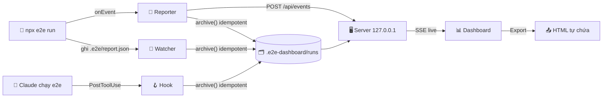

<div align="center">

# 🧪 e2e-dashboard

**Dashboard local cho [e2e](https://github.com/tester-army/e2e): theo dõi live, lưu lịch sử, debug test fail và chia sẻ report.**
**Chạy ngay trong Claude Code bằng một lệnh `/e2e-dashboard`.**


[✨ Tính năng](#-tính-năng) · [📸 Ảnh chụp](#-ảnh-chụp) · [🚀 Cài đặt](#-cài-đặt) · [📖 Hướng dẫn](#-hướng-dẫn-sử-dụng) · [⌨️ Lệnh](#️-lệnh) · [✨ AI](#-phân-tích-bằng-ai) · [📊 Phân tích](#-phân-tích-m2) · [🔗 Tích hợp](#-tích-hợp-m3) · [🧰 Mở rộng](#-mở-rộng-m6) · [📈 Theo dõi](#-theo-dõi--báo-cáo-m7) · [🚦 Trạng thái](#-trạng-thái--ngưỡng) · [⚙️ Cấu hình](#️-cấu-hình) · [🔄 Cập nhật](#-cập-nhật--phát-hành) · [🔒 Bảo mật](#-bảo-mật) · [🛠️ Phát triển](#️-phát-triển) · [🗺️ Roadmap](#️-roadmap)


</div>

---

## ✨ Tính năng

| | Tính năng | Mô tả |
|:-:|---|---|
| 📡 | **Theo dõi live** | Tiến độ từng test và step, biểu đồ Gantt theo làn, ước lượng thời gian còn lại (ETA) |
| 🗂️ | **Lịch sử không cần database** | Mỗi run là một thư mục file (`report.json`, `meta.json`, trace, artifact). Giữ 50 run gần nhất, run đã ghim được giữ mãi |
| 🚦 | **KPI có màu sức khoẻ** | Pass rate, run gần nhất, thời gian, token, replay cache tự chuyển 🟢 Tốt · 🟡 Cần chú ý · 🔴 Có vấn đề |
| ▶️ | **Chạy & chạy lại test** | Chọn test (hoặc *Chọn tất cả fail*) → hộp thoại Run: target, agent, retries, repeat-each, `--no-cache` → xem live ngay; run mới ghi lại là chạy lại của run nào |
| ✨ | **Phân tích bằng AI** | Nút *Phân tích lỗi* / *Phân tích run* gọi `claude -p` (không cần API key): phân loại lỗi app / test / flaky / môi trường, bằng chứng `file:line`, gợi ý sửa, hỏi tiếp |
| 🔍 | **Debug test fail** | Timeline của agent (suy nghĩ, thao tác, chuyển trang), video đồng bộ theo step, screenshot lúc fail, log, trace |
| 📊 | **Biểu đồ hiện đại** | Area có gradient, donut, sparkline, stacked bar, heatmap test × run, thanh ngang test chậm nhất |
| 🧮 | **Ma trận test × target** | Thấy ngay lỗi chỉ xảy ra trên một trình duyệt hoặc thiết bị |
| 🌿 | **Git context** | Mỗi run ghi branch, commit, có thay đổi chưa commit hay không |
| 📤 | **Export HTML** | Một file tự chứa (ảnh nhúng base64, có CSP) để gửi qua chat, email hoặc đính kèm issue |
| 🌗 | **Sáng / Tối** | Tự theo hệ điều hành, có nút chuyển và nhớ lựa chọn |
| 📑 | **Giao diện kiểu báo cáo** | Status viết hoa căn giữa; bảng có tiêu đề viết hoa, cột số căn phải in đậm; cột pass rate / fail / flaky tự tô màu đánh giá (xanh · vàng · đỏ); số quan trọng nổi bật |
| 🎨 | **Tô màu code & dữ liệu** | JSON (tự dàn dòng), code JS/TS, lệnh shell, `file:line`, log tô theo mức lỗi: ở Run detail, phân tích AI, config, bisect |
| 💫 | **Hoạt cảnh trạng thái** | Thanh tiến trình khi đang tải, nút quay khi đang xử lý, nhãn *Đang chạy 3/9* nổi trên mọi trang, nhịp live ở trang Live; tự tắt khi hệ điều hành bật *giảm chuyển động* |
| 🔗 | **Deep link** | Mỗi run và mỗi test có URL riêng (`#/run/<id>/test/<id>`) |
| 🔄 | **Tự cập nhật** | `/e2e-dashboard update` lấy tag mới nhất rồi tự `/reload-plugins` |
| ❤️ | **Health score** | Một điểm 0–100 cho cả suite: pass rate, độ ổn định, thời gian, token, replay cache |
| 🔀 | **Flaky** | Test pass nhờ retry hoặc đổi kết quả giữa các run (nặng hơn khi cùng commit), nút *Chạy ×5* để xác nhận |
| ⚖️ | **So sánh 2 run** | Mới fail / đã sửa / vẫn fail / thành flaky, chênh thời gian, token, chi phí; kèm **visual diff** screenshot |
| 🧩 | **Nhóm lỗi** | Gom lỗi cùng mã và cùng dạng thông báo: sửa một chỗ, hết nhiều test |
| 🪙 | **Chi phí & cache** | Token, chi phí ước tính, ngân sách, kết quả replay cache và lý do miss, step chậm nhất |
| 🗺️ | **Bản đồ route** | Các trang test đi qua và nơi hay fail |
| 🌿 | **So sánh branch** | Test nào chỉ hỏng ở một branch |
| 📁 | **Nhiều project** | Mọi project đã mở dashboard trên máy, kèm health score và nút mở |
| 🎫 | **Gửi Linear** | Tạo issue từ test fail, **chống trùng** bằng fingerprint; không có API key thì nhờ Claude + Linear MCP |
| 📰 | **Digest tuần** | Tóm tắt Markdown để dán vào Slack/email |
| 📟 | **Status line** | Kết quả run mới nhất (hoặc tiến độ) ngay trong Claude Code |
| 🔔 | **Thông báo desktop** | Báo khi run fail (hoặc mọi run) |
| 🔎 | **Tìm kiếm Ctrl K** | Test, mã lỗi, URL, branch, commit, run id trong 50 run gần nhất, không phân biệt dấu |
| 🔒 | **Cách ly test flaky** | Bỏ test khỏi các run có thời hạn, lệnh `--grep-invert` cho CI, digest nhắc test quá hạn |
| 🧬 | **Tìm commit gây lỗi** | Lần pass gần nhất → lần fail đầu tiên, sinh sẵn lệnh `git bisect run` cho đúng test đó |
| ⚡ | **Bất thường** | Test chậm hoặc tốn token hơn hẳn lịch sử của chính nó (TB + 2σ), có thông báo desktop |
| 🧠 | **Model & ngân sách** | So sánh các model theo `step.model`: tỉ lệ pass, token, thời gian, $ mỗi step, ngân sách theo model |
| ✅ | **Lint câu lệnh agent** | Thiếu bước kiểm tra (cache không được ghi), gộp nhiều mục tiêu, mơ hồ, quá dài, tốn model call |
| 👥 | **CODEOWNERS** | Owner của test hiện ở Run detail, issue Linear và digest |
| ☁️ | **Nhập từ CI** | `report.json` hoặc artifact GitHub Actions (`gh run download`) vào lịch sử, nguồn `ci` |
| 🤝 | **Thư mục team** | `share push/pull`: đẩy và kéo run qua một thư mục chung (đồng bộ / mạng) |
| 💬 | **Comment PR** | Đăng kết quả so sánh 2 run lên PR đang mở của branch qua `gh` |
| 📄 | **Trang riêng từng test** | Pass rate, biểu đồ thời gian/token, các lần fail, step gần nhất, ảnh fail theo thời gian, owner, cách ly |
| 🐞 | **Lỗi phía app** | Lỗi console và request 4xx/5xx từ `appLog`, gom theo dạng, commit đầu tiên xuất hiện |
| 🎯 | **Test bị ảnh hưởng** | Từ `git diff` so với `main`: file test, route đã đi qua, tên test → một nút chạy |
| 💬 | **Hỏi AI tự do** | Hỏi về cả bộ test, Claude nhận tóm tắt 30 run gần nhất |
| ⏱️ | **Setup & hook** | Thời gian setup, beforeEach, afterEach so với thân test |
| 👀 | **Watch & lịch chạy** | Lưu file test là chạy lại; chạy hằng ngày theo giờ đặt sẵn |
| 📣 | **Webhook Slack/Discord** | Run fail, bất thường, digest tuần |
| ✅ | **Trạng thái commit GitHub** | Gắn ✓/✗ của run lên commit qua `gh` |
| 🧭 | **Explore → test** | Xem goal/bước/finding của `e2e explore`, nhờ AI viết nháp test |
| 💾 | **Dung lượng** | Xem dung lượng theo loại, xoá video cũ, xoá run, giữ run fail lâu hơn |
| ⌨️ | **Phím tắt & bộ lọc trên URL** | `?`, `g`+phím, `/`, `j`/`k`/`r`/`a`/`l` ở trang run; link chia sẻ mở đúng bộ lọc |
| 🎯 | **Agent step → locator** | Step `agent.act` replay ổn định được dựng thành code `screen.getByRole(...)` từ cache của e2e |
| 🔌 | **MCP server** | Claude Code hỏi thẳng lịch sử test: `e2e_runs`, `e2e_run`, `e2e_test`, `e2e_flaky`, `e2e_errors`, `e2e_search`, `e2e_health`, `e2e_gate`, `e2e_coverage`, `e2e_digest` |
| 🛠️ | **Sửa bằng Claude Code** | Nút ở test fail copy lệnh `/e2e-dashboard:e2e-dashboard fix <run> <test>`: Claude đọc lỗi, sửa app hoặc test, chạy lại đúng test đó |
| 🕳️ | **Khoảng trống coverage** | Trang của app (`app/`, `pages/`, `src/routes`, `sitemap.xml`, router) chưa test nào đi qua, nút nhờ AI viết test |
| 🚧 | **Cổng chất lượng** | `/e2e-dashboard gate`: trả mã lỗi khi có test mới fail, health/SLO dưới ngưỡng, vượt token |
| 🌐 | **Lỗi theo môi trường** | Tỉ lệ fail theo target, OS, trình duyệt, phiên bản e2e, giờ chạy, branch; chỉ ra nơi fail tập trung |
| 🎯 | **SLO** | Pass rate mục tiêu trong N ngày, budget lỗi còn lại, tốc độ đốt |
| 📣 | **Mention owner** | Webhook run fail tag owner (theo CODEOWNERS) của test fail |
| 🇬🇧 | **Giao diện tiếng Anh (beta)** | Nút VI/EN ở cuối sidebar |
| 🎞️ | **Video cạnh nhau** | Video của 2 run phát đồng bộ ở trang So sánh |
| 🖨️ | **Báo cáo & CSV** | Trang in / lưu PDF, xuất CSV run, test, flaky |
| 🆕 | **Có gì mới** | Hiện thay đổi sau mỗi lần cập nhật |
| 📈 | **Xu hướng dài hạn** | Số liệu gom theo ngày, giữ mãi (kể cả khi run cũ đã bị xoá), xem 30–365 ngày, lịch nhiệt 12 tháng |
| 🎫 | **Triage lỗi** | Mỗi lỗi có trạng thái, người phụ trách, ghi chú, link Linear; tự mở lại khi fail lại, tự đóng khi pass |
| ⏱️ | **MTTR & thời gian đỏ** | Thời gian từ lúc fail đến lúc sửa, branch chính đỏ bao lâu, test hỏng lâu nhất |
| 📬 | **Báo cáo tự gửi** | Báo cáo tuần / tháng theo lịch, gửi Slack (webhook) và email |
| 🧱 | **Theo module / team** | Bảng điểm A–F theo thư mục, tag hoặc CODEOWNERS |
| 🚀 | **Báo cáo phát hành** | So run ở tag git với tag trước, kết luận sẵn sàng hay chưa |
| 🔗 | **Truy vết yêu cầu** | Story ↔ test (`@LIN-123`), story nào chưa có test |
| 🔄 | **Tự đồng bộ CI** | Kéo report từ GitHub Actions theo chu kỳ |
| 🚨 | **Cảnh báo tuỳ chỉnh** | Fail N lần liên tiếp, pass rate dưới ngưỡng, flaky tăng, branch đỏ quá lâu → Slack + tag owner |
| 📍 | **Sự kiện trên biểu đồ** | Deploy, release, sự cố đánh dấu trên biểu đồ xu hướng |
| 🌱 | **Vòng đời test** | Test mới, bị bỏ, đổi tên, luôn fail, commit sửa gần nhất |
| 🌐 | **Trang báo cáo tĩnh** | Xuất cả lịch sử thành thư mục HTML cho GitHub Pages / thư mục chung |
| ⚙️ | **Cài đặt hệ thống** | Theme, cỡ chữ, ngôn ngữ; xem và sửa trực tiếp `.env` / `.env.local` (lưu thẳng vào file, file có secret tự vào `.gitignore`); Linear key, webhook, setup và doctor |
| 🌐 | **Chọn trình duyệt** | Chromium mặc định, đổi trong Cài đặt: chạy test bằng Firefox hoặc WebKit, kể cả lịch chạy |
| 🛠️ | **Tự sửa lỗi dashboard (có duyệt)** | Lỗi của chính dashboard được AI phân tích và sửa trên branch riêng. **Dừng chờ bạn duyệt diff**; chỉ khi bấm *Chạy test & tạo PR* mới chạy `npm test`, push và mở PR draft |
| ✨ | **AI mở rộng** | Tóm tắt run, giải thích nhóm lỗi, triage, vì sao chậm, viết test từ ticket, chọn test bị ảnh hưởng, gom locator, tìm test trùng, nháp release notes, giải thích visual diff |
| 📦 | **Dữ liệu theo ngày + SQLite tuỳ chọn** | Run lưu theo `runs/YYYY/MM/DD/`, trạng thái ở `state/`, file tạm ở `runtime/`. Chỉ mục SQLite (tắt mặc định) cho lịch sử lớn |
| 🧹 | **Dọn run theo khoảng ngày** | Lọc theo trạng thái và khoảng thời gian rồi xoá run cũ trong một lần |
| 🗂️ | **Thu gọn menu & phóng to** | Menu trái gập thành thanh icon; mỗi chart, bảng, danh sách phóng to toàn màn hình (Esc để thoát) |
| 🧾 | **Linear có xem trước** | Sửa tiêu đề và nội dung, xem trước, nhờ AI viết lại theo giọng tự nhiên, đính kèm ảnh minh hoạ trước khi gửi |

> [!TIP]
> **Không cài thêm gì.** Plugin chỉ cần Node (e2e vốn đã cần), không có dependency npm, không bước build, không tải CDN, nên chạy được cả khi không có mạng.

---

## 📸 Ảnh chụp

<table>
  <tr>
    <td width="50%"><b>🌙 Overview — chế độ tối + panel "Cách tính trạng thái"</b><br></td>
    <td width="50%"><b>🔍 Run detail — timeline agent, lỗi, log</b><br></td>
  </tr>
  <tr>
    <td width="50%"><b>📡 Live — Gantt theo làn, ETA</b><br></td>
    <td width="50%"><b>✨ Phân tích lỗi bằng AI (claude -p)</b><br></td>
  </tr>
  <tr>
    <td width="50%"><b>⚖️ So sánh 2 run + visual diff</b><br></td>
    <td width="50%"><b>🔀 Flaky</b><br></td>
  </tr>
  <tr>
    <td width="50%"><b>🗺️ Bản đồ route</b><br></td>
    <td width="50%"><b>🎯 Gợi ý locator từ replay cache</b><br></td>
  </tr>
  <tr>
    <td width="50%"><b>📄 Trang riêng từng test</b><br></td>
    <td width="50%"><b>⚙️ Cài đặt hệ thống</b><br></td>
  </tr>
</table>

---

## 🚀 Cài đặt

> [!IMPORTANT]
> Cần một project đã dùng **e2e** (có `e2e.config.ts`). e2e bản mới yêu cầu **Node ≥ 22.22.3** (hoặc ≥ 24.8). Dashboard cần **Node ≥ 22**; chỉ mục SQLite tuỳ chọn cần Node ≥ 22.13.

**1️⃣ Thêm marketplace và cài plugin** (trong Claude Code):

```text
/plugin marketplace add thangvofastboy/e2e-dashboard
/plugin install e2e-dashboard@e2e-dashboard
/reload-plugins
```

**2️⃣ Mở dashboard** ở thư mục project e2e:

```text
/e2e-dashboard
```

**3️⃣ (Tuỳ chọn) Bật chế độ xem live:**

```text
/e2e-dashboard setup
```

Lệnh này copy `e2e-dashboard.reporter.mjs` (kèm `.d.mts`) vào project và thêm reporter vào `e2e.config.ts`. Output terminal của e2e vẫn giữ nguyên. Hãy commit 2 file reporter đó: trên CI (`CI=true`) reporter tự tắt, còn máy chưa cài plugin vẫn chạy test bình thường.

> [!NOTE]
> Không cài reporter vẫn có lịch sử: run do Claude chạy được lưu qua hook, run bạn tự chạy được lưu khi dashboard đang mở.

---

## 📖 Hướng dẫn sử dụng

<details open>
<summary>🧑‍💻 <b>Hằng ngày: chạy test và xem kết quả</b></summary>

1. Mở dashboard một lần: `/e2e-dashboard` (server chạy nền, lần sau gõ lại chỉ mở trình duyệt).
2. Chạy test như bình thường (`npx e2e run`, hoặc nhờ Claude chạy). Trang **Live** hiện tiến độ từng test, Gantt theo làn và ETA.
3. Run xong tự vào **Runs** và **Overview**: thẻ KPI đổi màu theo ngưỡng, health score 0–100, heatmap test × run.
4. Muốn chạy lại: trang **Tests** → tick test (hoặc *Chọn tất cả fail*) → **Chạy**; hoặc trang **Live** → *Chạy toàn bộ suite*.
5. Đang ở trang khác vẫn biết có run đang chạy: nhãn **● Đang chạy 3/9** nổi ở góc dưới, bấm vào là sang Live.
6. Đóng máy cũng không mất gì: lịch sử nằm trong `.e2e-dashboard/` của project. Tắt server bằng `/e2e-dashboard stop`.

</details>

<details>
<summary>🔍 <b>Một test fail: tìm nguyên nhân và sửa</b></summary>

1. **Runs** → bấm run fail → bấm test fail: xem timeline agent, video đồng bộ theo step, screenshot lúc fail, log app, trace.
2. **✨ Phân tích lỗi**: Claude phân loại lỗi app / test / flaky / môi trường, chỉ ra `file:line`, gợi ý sửa; hỏi tiếp trong panel.
3. Lỗi xuất hiện sau một commit? **Tìm commit gây lỗi** sinh sẵn lệnh `git bisect run` cho đúng test đó.
4. **Sửa bằng Claude Code** copy lệnh `/e2e-dashboard:e2e-dashboard fix <run> <test>`; dán vào Claude Code để Claude sửa rồi chạy lại đúng test đó.
5. Cần người khác xem: **Export** (một file HTML tự chứa), **Gửi Linear** (chống trùng), hoặc ghi người phụ trách ở **Triage lỗi**.

</details>

<details>
<summary>🔀 <b>Test lúc pass lúc fail (flaky)</b></summary>

1. Trang **Flaky** xếp test theo điểm; đổi kết quả trên **cùng commit** bị tính nặng hơn.
2. **Chạy ×5** để xác nhận; **Vì sao flaky?** để Claude đọc lịch sử pass/fail theo commit, timing, cache và code test.
3. Chưa sửa kịp: **Cách ly** (mặc định 14 ngày). Run từ dashboard bỏ qua test đó; `/e2e-dashboard quarantine` in lệnh `--grep-invert` cho CI; digest nhắc khi quá hạn.

</details>

<details>
<summary>🚦 <b>Trước khi push / merge</b></summary>

1. Trang **Tests** → *Test bị ảnh hưởng* (so với `main`) → chạy đúng những test liên quan tới thay đổi.
2. `/e2e-dashboard gate` trả mã thoát 1 khi có test mới fail, health hoặc SLO dưới ngưỡng, vượt ngân sách token. Dùng được trong CI.
3. Trang **So sánh 2 run** → *Đăng lên PR* để đưa kết quả (mới fail / đã sửa / vẫn fail) vào PR qua `gh`.

</details>

<details>
<summary>☁️ <b>CI và làm việc theo team</b></summary>

1. Reporter tự tắt khi `CI=true`. Để có lịch sử CI: upload `.e2e/report.json` làm artifact, rồi `import --gh <run id>` hoặc bật tự đồng bộ `"ci": { "github": { … } }` (cần `gh auth login`).
2. Dùng chung lịch sử: đặt `"share": { "dir": "…" }` trong `~/.e2e-dashboard/config.json`, rồi `share push` / `share pull`.
3. Đánh dấu deploy / release từ CI: `/e2e-dashboard mark deploy "v1.5"` (hiện trên biểu đồ xu hướng).
4. Xuất trang tĩnh cho cả team xem: `/e2e-dashboard publish` → thư mục HTML đưa lên GitHub Pages hoặc thư mục chung.

</details>

<details>
<summary>📬 <b>Báo cáo và cảnh báo</b></summary>

1. Digest tuần: `/e2e-dashboard digest` (Markdown để dán Slack/email). Báo cáo tuần / tháng: `/e2e-dashboard report week --send`.
2. Gửi tự động khi dashboard đang mở: `"reports": { "weekly": "mon 09:00" }` trong `.e2e-dashboard/config.json`.
3. Webhook Slack/Discord và email chỉ đặt ở `~/.e2e-dashboard/config.json` (không bao giờ trong repo). Xem [Cảnh báo](#-theo-dõi--báo-cáo-m7) để tuỳ chỉnh luật.
4. Hỏi nhanh ngay trong Claude Code, không cần mở dashboard: *"test nào flaky tuần này?"* (qua MCP server của plugin).

</details>

<details>
<summary>🩺 <b>Gặp sự cố</b></summary>

| Triệu chứng | Cách xử lý |
|---|---|
| `Unknown command: /e2e-dashboard` | `/reload-plugins` (hoặc mở lại Claude Code). Vẫn lỗi: dùng tên đầy đủ `/e2e-dashboard:e2e-dashboard` |
| `Không tìm thấy e2e.config…` | Chạy lệnh trong thư mục project e2e (hoặc thư mục con của nó) |
| Trang Live trống khi chạy test | Chưa gắn reporter: `/e2e-dashboard setup`. Không có reporter thì run vẫn được lưu khi xong |
| Trình duyệt báo `401` | Mở lại bằng `/e2e-dashboard` (URL có token mới; cookie theo từng port) |
| Không thấy run cũ | Retention mặc định giữ 50 run; tăng `"retention"`, ghim run cần giữ. Số liệu dài hạn ở trang **Xu hướng** không bị xoá |
| Server không lên | `/e2e-dashboard status`, xem `.e2e-dashboard/server.log`; port bận thì tự lấy port kế tiếp |
| Màu / hoạt cảnh gây rối mắt | Bật *giảm chuyển động* (Reduce motion) trong hệ điều hành: mọi hoạt cảnh tự tắt |
| Live báo *running* mãi, không chạy được run mới | Run ngoài terminal bị kill giữa chừng: bấm **Dừng run** ở trang Live để xoá trạng thái |
| `report --send` / `digest --send` trả mã 1 | Mọi webhook / email đều gửi lỗi: kiểm tra URL trong `~/.e2e-dashboard/config.json` |

</details>

---

## ⌨️ Lệnh

| Lệnh | | Việc |
|---|:-:|---|
| `/e2e-dashboard` | 🖥️ | Bật server nền nếu chưa chạy, mở trình duyệt, in URL |
| `/e2e-dashboard setup` | 🔌 | Gắn reporter vào `e2e.config.ts` để xem live; chọn trình duyệt mặc định (`E2E_BROWSER`) |
| `/e2e-dashboard doctor [--dry-run]` | 🩺 | Chuyển dữ liệu theo bố cục cũ sang bố cục mới (runs theo ngày, `state/`, `runtime/`), dựng lại chỉ mục SQLite nếu đã bật. `--dry-run` chỉ liệt kê, không ghi |
| `/e2e-dashboard export [runId]` | 📤 | Xuất một run (mặc định là run mới nhất) thành HTML tự chứa |
| `/e2e-dashboard status` | ℹ️ | Xem server có đang chạy không |
| `/e2e-dashboard digest [ngày]` | 📰 | In digest Markdown (mặc định 7 ngày), lưu vào `.e2e-dashboard/digests/` |
| `/e2e-dashboard projects` | 📁 | Liệt kê các project đã mở dashboard, health score, URL nếu đang chạy |
| `/e2e-dashboard statusline [install]` | 📟 | Hướng dẫn / cài status line cho Claude Code |
| `/e2e-dashboard quarantine` | 🔒 | Test đang cách ly và lệnh `npx e2e run --grep-invert …` cho CI |
| `/e2e-dashboard import <report.json\|thư mục>` | ☁️ | Nhập report (vd. tải từ CI) vào lịch sử; `import --gh <run id> [--name <artifact>]` tải qua `gh` |
| `/e2e-dashboard share push\|pull [dir]` | 🤝 | Đẩy run của bạn / kéo run của team qua thư mục chung |
| `/e2e-dashboard gate [--max-new-failures N] [--min-health N] [--max-tokens N] [--slo 0.95]` | 🚧 | Cổng chất lượng cho CI / trước khi push; mã thoát 1 khi FAIL |
| `/e2e-dashboard fix [runId] [resultId]` | 🛠️ | In ngữ cảnh test fail; dùng `/e2e-dashboard:e2e-dashboard fix …` để Claude sửa và chạy lại |
| `/e2e-dashboard report [week\|month] [--send]` | 📬 | Báo cáo tuần / tháng (Markdown + HTML); `--send` gửi webhook và email |
| `/e2e-dashboard publish [thư mục]` | 🌐 | Xuất trang báo cáo tĩnh (mặc định `.e2e-dashboard/site`) |
| `/e2e-dashboard mark <deploy\|release\|incident\|env\|note> <mô tả>` | 📍 | Đánh dấu sự kiện lên biểu đồ (dùng được trong CI) |
| `/e2e-dashboard triage` | 🎫 | Lỗi đang cần xử lý và trạng thái |
| `/e2e-dashboard ci-sync` | 🔄 | Kéo report mới từ GitHub Actions ngay |
| `/e2e-dashboard version` | 🏷️ | Version đang cài và có bản mới không (chạy local, không tốn token) |
| `/e2e-dashboard update` | 🔄 | Cập nhật lên tag mới nhất rồi tự `/reload-plugins` |
| `/e2e-dashboard stop` | ⏹️ | Tắt server |

> [!TIP]
> Tất cả lệnh trên chạy local, không tốn token. Nếu cần Claude tự sửa `e2e.config.ts` (config có dạng lạ), dùng tên đầy đủ `/e2e-dashboard:e2e-dashboard setup`: lệnh này nhờ Claude chèn reporter giúp.

---

## ✨ Phân tích bằng AI

Trên trang run: **✨ Phân tích run** (tóm tắt, gom nhóm lỗi, ưu tiên xử lý) hoặc, ở test fail, **✨ Phân tích lỗi**. Kết quả chạy dần trong panel bên phải; *Phân tích lại* bỏ qua cache; ô *Hỏi thêm* tiếp tục cùng phiên (`--resume`).

| | |
|:-:|---|
| 🧠 | Dùng Claude Code CLI bạn đang đăng nhập (`claude -p`), **không cần API key** |
| 🧾 | Prompt gồm lỗi, timeline step, log app, đường dẫn trace và **commit giữa lần pass gần nhất với run này** |
| 🗃️ | Kết quả cache theo run (`runs/<run>/ai/`), xoá theo retention, **nhúng vào file export** |
| 🛡️ | Sandbox: `--restricted`, chỉ có `Read/Grep/Glob`, không MCP, từ chối mọi quyền khác; text của app được rào bằng thẻ có nonce |
| ⏱️ | Tối đa 2 phân tích cùng lúc, timeout 5 phút, đóng panel là dừng |
| 🔀 | **Vì sao flaky?** ở trang Flaky: Claude đọc lịch sử pass/fail theo commit, cache, timing và code test, tách flaky thật khỏi regression |
| 🎯 | **Chuyển thành locator** trên step `agent.act`: Claude đọc test và bản ghi cache, đề xuất code locator thay cho bước agent |

---

## 📊 Phân tích (M2)

Các trang ở nhóm **Phân tích** trên sidebar; mỗi trang chọn được số run gần nhất để phân tích (10–100).

| Trang | Cách tính |
|---|---|
| ❤️ **Health score** (Overview) | Pass rate TB 10 run ×40, độ ổn định (ít flaky) ×25, thời gian so với TB ×15, token so với TB ×10, replay cache ×10; phần chưa có dữ liệu không tính |
| 🔀 **Flaky** | Điểm = tỉ lệ run flaky + tỉ lệ lần đổi kết quả, cộng thêm khi đổi kết quả trên **cùng commit**. Hỏng một lần sau commit mới là regression, không phải flaky |
| ⚖️ **So sánh 2 run** | Chọn 2 run ở trang Runs, hoặc nút *So với baseline / run trước* ở Run detail. Nút 🖼️ trên mỗi dòng mở visual diff |
| 🖼️ **Visual diff** | Cạnh nhau, thanh trượt, hoặc *Khác biệt* (so từng pixel bằng canvas, tô đỏ chỗ khác, % pixel khác). Tự nhận bộ ảnh `-expected / -actual / -diff` của `toHaveScreenshot` |
| 🧩 **Nhóm lỗi** | Chữ ký = mã lỗi + thông báo đã bỏ số, chuỗi trong ngoặc, id, URL + locator. Run detail cũng có panel nhóm lỗi |
| 🪙 **Chi phí & cache** | `usage.estimatedCostUsd` của report, hoặc ước tính theo `"pricing"`; cảnh báo khi vượt `"budget"` |
| 🗺️ **Bản đồ route** | Từ sự kiện navigation, `step.screen.location` và URL lúc fail; id trong path gộp thành `:id` |
| 🌿 **Branch** | Chỉ số 10 run gần nhất mỗi branch, pass rate từng test trên A so với B |
| 🎯 **Gợi ý locator** | Step `agent.act` replay từ cache ở ≥ 3 run: đọc `.e2e/cache/<entry>.json` (trace-1) và dựng code `screen.getByRole(...).tap()`, `.fill()`, `.selectOption()`, `app.open()`… kèm một `expect` |

> [!TIP]
> Muốn visual diff giữa hai run kể cả khi test pass, bật `"screenshots": "all"`: run pass cũng giữ screenshot (không giữ video).

---

## 🔗 Tích hợp (M3)

**🎫 Linear.** Ở test fail bấm **Gửi Linear**. Nội dung issue gồm lỗi, step fail, URL, commit kể từ lần pass, phân tích AI đã lưu, và dòng `fingerprint: e2ed-…` (tên test + dạng lỗi).

- Có `LINEAR_API_KEY` (và `LINEAR_TEAM`, vd. `ENG`, khi tài khoản có nhiều team): server tìm issue chứa fingerprint trước. Đang mở → báo trùng, nút *Thêm comment run này*; đã đóng → tạo issue mới ghi "Tái phát của …"; chưa có → tạo mới.
- Không có key: **Copy cho Claude** tạo prompt để Claude Code dùng Linear MCP làm đúng các bước trên.
- Key chỉ đọc từ biến môi trường hoặc `~/.e2e-dashboard/config.json` → `"linear": { "apiKey", "team" }`, **không bao giờ** từ repo.

**📰 Digest tuần.** Trang *Digest tuần* hoặc `/e2e-dashboard digest`: số run, pass rate so với tuần trước, token, replay cache, health score, test mới fail, flaky, nhóm lỗi, step chậm nhất. Muốn tự động hằng tuần: tạo Routine trong Claude Code chạy `/e2e-dashboard digest`.

**📟 Status line.** `/e2e-dashboard statusline install` copy script vào `~/.e2e-dashboard/statusline.mjs` và đặt `statusLine` trong `~/.claude/settings.json` (không ghi đè status line có sẵn). Hiện `🧪 e2e ✓ 42/42 · 97% (10 run) · 5p trước`, hoặc `▶ e2e 3/9` khi đang chạy. Chỉ đọc file, không gọi mạng, im lặng ngoài project e2e.

**🔔 Thông báo desktop.** Khi dashboard đang chạy và một run kết thúc: `osascript` (macOS), `notify-send` (Linux), balloon PowerShell (Windows). Mặc định chỉ báo run fail/flaky; đổi bằng `"notify": "all" | "failures" | "off"`.

**🔒 Cách ly test flaky.** Ở trang Flaky bấm *Cách ly* (14 ngày, kèm lý do). Hộp thoại Run có ô *Bỏ qua test đang cách ly*; `/e2e-dashboard quarantine` in lệnh `--grep-invert` để dùng trong CI. Hết hạn mà chưa gỡ thì digest nhắc.

**🧬 Tìm commit gây lỗi.** Ở test fail bấm *Tìm commit gây lỗi*: dashboard tìm lần pass gần nhất và lần fail đầu tiên, rồi sinh `git bisect start <bad> <good>` + `git bisect run npx e2e run <file:line> --no-cache --retries 0`. Dashboard không tự checkout: bạn chạy lệnh trong terminal.

**☁️ CI và 🤝 team.** Reporter tự tắt trên CI; để xem lịch sử CI, tải artifact chứa `.e2e/report.json` (*Nhập từ GitHub Actions* ở trang Runs, hoặc `import --gh <run id>`). Team dùng chung một thư mục (`"share": { "dir": "…" }` trong `~/.e2e-dashboard/config.json`): `share push` đẩy run của bạn, `share pull` kéo run của người khác (kiểm tra id, schema, không theo symlink; hiện với nguồn `shared`).

**💬 Comment PR.** Ở trang So sánh 2 run bấm *Đăng lên PR*: xem trước Markdown, rồi đăng qua `gh pr comment` lên PR đang mở của branch run B (cần `gh auth login`).

**📄 Trang test.** Bấm tên test ở Tests, Flaky, Tìm kiếm hay trang Run để xem toàn bộ lịch sử của test đó.

**🎯 Test bị ảnh hưởng.** Ở trang Tests, nhập nhánh gốc (mặc định `main`) rồi bấm *Tìm*: dashboard đọc `git diff` (đã commit, chưa commit, file mới), ghép với file test, các route test đã đi qua và từ khoá trong tên test, rồi cho chạy đúng những test đó.

**👀 Watch, lịch chạy, webhook.** Trang *Tự động & lưu trữ*: bật watch (lưu `*.e2e.ts` là chạy lại file đó); lịch chạy `"schedule": { "daily": ["02:00"], "tests": [] }` trong config; webhook đặt ở `~/.e2e-dashboard/config.json` → `"webhooks": [{ "url": "https://hooks.slack.com/…", "events": ["run-failed", "digest"] }]` (hoặc `E2E_DASHBOARD_WEBHOOK`), digest tuần gửi bằng `/e2e-dashboard digest --send`. Mọi thứ chỉ chạy khi dashboard đang mở và bỏ qua test đang cách ly.

**📁 Nhiều project.** Mỗi lần mở dashboard, project được ghi vào `~/.e2e-dashboard/projects.json`. Trang *Projects* hiện mọi project, run gần nhất, health score, nút mở (nếu server đang chạy) hoặc lệnh để mở.

---

## 🚦 Trạng thái & ngưỡng

Mỗi thẻ KPI tự đổi màu theo ngưỡng. Bấm vào chip trạng thái để mở panel **"Cách tính trạng thái"**: ô ứng với giá trị hiện tại được viền màu và gắn nhãn *hiện tại*.

| Chỉ số |  |  |  |
|---|---|---|---|
| 🎯 Pass rate | ≥ 95% | 80–95% | < 80% |
| ✅ Run gần nhất | passed | flaky / blocked | failed / interrupted / error |
| ⏱️ Thời gian chạy | ≤ +10% so với TB 10 run | +10% → +30% | > +30% |
| 🪙 Token / run | ≤ +10% so với TB 10 run | +10% → +30% | > +30% |
| ♻️ Replay cache | ≥ 80% | 50–80% | < 50% |

Màu không bao giờ đứng một mình: mọi trạng thái đều có icon kèm chữ, để người mù màu và bản in vẫn đọc được.

---

## 🧰 Mở rộng (M6)

**🔌 MCP server.** Plugin tự khai báo server MCP `e2e-dashboard` (`.mcp.json`), nên trong Claude Code có thể hỏi *"test nào flaky tuần này?"*, *"vì sao run vừa rồi fail?"* mà không cần mở dashboard. Server chỉ đọc lịch sử trong `.e2e-dashboard/`, không chạy test.

**🛠️ Sửa bằng Claude Code.** Ở test fail bấm *Sửa bằng Claude Code* → lệnh được copy; dán vào Claude Code. Claude nhận lỗi, step fail, trace, phân tích AI đã lưu, commit kể từ lần pass, quyết định lỗi ở app hay ở test, sửa tối thiểu (không bao giờ xoá hay skip test) rồi chạy lại `npx e2e run <spec> --retries 0`.

**🕳️ Coverage.** Dashboard đọc route của app rồi so với các trang test đã đi qua. Thêm/bỏ route bằng `"coverage": { "routes": ["/help"], "ignore": ["/admin/*"] }`.

**🚧 Cổng chất lượng & 🎯 SLO.** Panel ở Overview và lệnh `gate`. Ngưỡng mặc định: 0 test mới fail; đổi bằng `"gate": { "maxNewFailures": 0, "minHealth": 70, "maxTokens": 200000, "requireSlo": true }` và `"slo": { "passRate": 0.95, "days": 7 }`. So với baseline nếu đã đặt, không thì với run trước.

**📣 Mention owner.** Trong `~/.e2e-dashboard/config.json` (không phải repo): `"mentions": { "@team-web": "<!subteam^S123>", "@ana": "<@U456>" }`. Webhook run fail sẽ tag owner của test fail.

**🎞️ Video.** Để có video của cả test pass (so sánh cạnh nhau), đặt `"videos": "all"`.

---

## 📈 Theo dõi & báo cáo (M7)

**📈 Số liệu dài hạn.** Retention chỉ giữ 50 run, nên mỗi run còn được gom vào `.e2e-dashboard/longterm/` (tổng theo ngày, mỗi test một dòng `[run, fail, flaky]`, các đợt fail → pass). File nhỏ và được giữ mãi; trang **Xu hướng** đọc từ đây: pass rate theo ngày, lịch 12 tháng, MTTR, thời gian đỏ, test fail lâu nhất.

**🎫 Triage.** Trang *Triage lỗi* liệt kê mọi test đang fail. Chọn trạng thái, người phụ trách, ghi chú; link Linear tự gắn nếu đã gửi issue. Trạng thái gắn với đúng lỗi (tên test + dạng lỗi), nên run ngày mai fail như cũ thì không ai phải xem lại.

**📬 Báo cáo tự gửi.** `"reports": { "weekly": "mon 09:00", "monthly": "1 09:00" }` trong `.e2e-dashboard/config.json`. Khi dashboard đang mở, đến giờ sẽ tạo báo cáo (lưu `.e2e-dashboard/reports/*.html`), gửi webhook có sự kiện `report` và email nếu `~/.e2e-dashboard/config.json` có `"email": { "to": ["qa@công-ty.com"] }` (gửi qua `sendmail` trên máy).

**🚨 Cảnh báo.** Mặc định: test fail 3 run liên tiếp, branch chính đỏ quá 24 giờ. Tuỳ chỉnh:

```jsonc
"alerts": [
  { "type": "consecutive-failures", "count": 3 },
  { "type": "pass-rate-below", "value": 0.9, "runs": 10, "scope": "module:checkout" }, // hoặc "tag:@smoke", "owner:@team-qa"
  { "type": "flaky-increase", "factor": 2, "days": 7 },
  { "type": "red-for", "hours": 4, "branch": "main" }
]
```

**🔄 Tự đồng bộ CI.** `"ci": { "github": { "workflow": "e2e.yml", "artifact": "e2e-report", "branch": "main", "intervalMinutes": 30 } }` (cần `gh auth login`).

**🧱 Module, 🔗 truy vết, 📍 sự kiện.** `"modules": { "Checkout": ["tests/checkout/**"] }` (mặc định theo thư mục); `"traceability": { "stories": ["LIN-1", { "id": "LIN-2", "title": "…" }] }` + tag `@LIN-1` trên test; sự kiện thêm ở trang Xu hướng hoặc `/e2e-dashboard mark deploy "v1.5"`. Branch chính: `"mainBranch": "main"` (mặc định main/master).

**🌐 Trang tĩnh.** `/e2e-dashboard publish [thư mục]` xuất `index.html` (90 ngày + lịch 12 tháng) và 10 run gần nhất. Thư mục mặc định `.e2e-dashboard/site`, hoặc `"publish": { "dir": … }` trong `~/.e2e-dashboard/config.json`.

---

## ⚙️ Cấu hình

Mọi thứ đều tuỳ chọn. Tạo `.e2e-dashboard/config.json` trong project e2e:

```jsonc
{
  "output": ".e2e",        // thư mục output của e2e (nếu bạn đổi --output)
  "retention": 50,         // số run giữ lại (run đã ghim không tính)
  "port": 4477,            // port ưu tiên; bận thì tự lấy port kế tiếp
  "ai": { "model": "sonnet", "language": "vi" },  // model và ngôn ngữ trả lời của AI
  "thresholds": {          // ghi đè ngưỡng trạng thái (tỉ lệ 0–1)
    "passRate": { "good": 0.98, "warn": 0.9 },
    "duration": { "good": 0.05, "warn": 0.2 }
  },
  "screenshots": "all",    // giữ screenshot cả của test pass (mốc cho visual diff)
  "pricing": { "inputPerMTok": 3, "outputPerMTok": 15 },  // ước tính chi phí khi report không có
  "budget": { "tokensPerRun": 200000, "costPerRun": 0.5 }, // cảnh báo vượt ngân sách
  "notify": "failures",    // "all" | "failures" | "off"
  "cacheDir": ".e2e/cache", // nếu đổi thư mục replay cache của e2e
  "linear": { "team": "ENG" }, // gợi ý team; API key KHÔNG đặt ở đây
  "budget": { "perModel": { "anthropic/claude-sonnet-4.5": 5 } } // (gộp với budget ở trên) USD theo model
}
```

<details>
<summary>🗂️ <b>Dữ liệu được lưu ở đâu?</b></summary>

```text
<project>/.e2e-dashboard/
├── .gitignore              ← "*": cả thư mục tự bị git bỏ qua
├── config.json             ← (tuỳ chọn) cấu hình ở trên
├── config.json             ← (tuỳ chọn) cấu hình ở trên
├── server.json             ← port + token khi server đang chạy (quyền 0600)
├── state/                  ← cài đặt, triage, cách ly, Linear đã gửi, sự kiện, cảnh báo, CI sync…
├── runtime/                ← server.log, live.json (tiến độ run hiện tại, cho status line)
├── cache/index.sqlite      ← chỉ mục SQLite (chỉ khi bật trong Cài đặt; xoá đi là dựng lại)
├── longterm/               ← số liệu gom theo ngày, giữ mãi (trang Xu hướng)
├── reports/                ← báo cáo tuần / tháng (.html + .md)
├── digests/<ngày>.md       ← digest đã in
├── exports/run-<id>.html   ← file export
├── site/                   ← trang tĩnh (`publish`)
└── runs/YYYY/MM/DD/<giờ>_<runId>/
    ├── report.json         ← bản copy nguyên văn report của e2e
    ├── meta.json           ← tóm tắt: status, số test, token, git, ghim/baseline
    ├── traces/<resultId>.md
    ├── ai/                 ← cache phân tích AI
    └── artifacts/…         ← video / screenshot / log của test không pass
```

Muốn sao lưu thì copy thư mục, muốn xoá lịch sử thì xoá thư mục.
</details>

<details>
<summary>🧭 <b>Cách hoạt động</b></summary>



Ba nguồn (reporter, watcher, hook) cùng gọi một hàm `archive()`. Hàm này lấy `run.id` làm khoá và ghi qua thư mục tạm rồi `rename`, nên một run chỉ được lưu đúng một lần.
</details>

---

## 🔄 Cập nhật & phát hành

**Người dùng:** gõ `/e2e-dashboard version` để xem có bản mới, `/e2e-dashboard update` để cập nhật. Lệnh chạy `claude plugin marketplace update` + `claude plugin update`, rồi tự gọi `/reload-plugins`: không cần khởi động lại Claude Code.

**Người phát hành:** mỗi lần merge vào `main` là một bản phát hành có tag `vX.Y.Z`.

```bash
npm run release -- minor          # patch | minor | major | X.Y.Z
npm run release -- minor --push   # đẩy luôn main + tag lên GitHub
```

Script kiểm tra (`npm test`, `claude plugin validate`, `claude plugin test`), nâng version ở `plugin.json`, `package.json`, reporter, **ghim `marketplace.json` vào tag mới**, commit và tạo tag. Workflow `.github/workflows/tag-on-main.yml` tự gắn tag cho version trên `main` nếu còn thiếu (ví dụ khi merge PR trên GitHub).

---

## 🔒 Bảo mật

| | Biện pháp |
|:-:|---|
| 🏠 | Server chỉ nghe `127.0.0.1` và kiểm tra header `Host` (chống DNS rebinding) |
| 🔑 | Mọi request cần token: cookie `HttpOnly; SameSite=Strict` riêng theo từng port. Request POST còn phải có `Origin` khớp |
| 🧱 | Không bao giờ đi theo symlink do repo gài sẵn khi lưu, export hay phục vụ file |
| 🧼 | Mọi nội dung lấy từ report (lỗi, log, reasoning) đều được escape. Link Markdown chỉ nhận `http(s)` |
| 📄 | Artifact HTML/SVG được trả về dạng text kèm `CSP: sandbox`. File export có CSP riêng dựa trên hash |
| 🤐 | Reporter tự tắt trên CI và không bao giờ throw hay làm hỏng run của e2e |
| ▶️ | Lệnh chạy test được dựng từ danh sách tham số đã kiểm tra (`file:line`, tên target/agent, số nguyên có giới hạn), không qua shell, mỗi project một run |
| ✨ | `claude -p` chạy sandbox: không shell, không MCP, chỉ đọc file; dữ liệu report được rào và đánh dấu không tin cậy |
| 🎫 | API key Linear chỉ lấy từ môi trường hoặc `~/.e2e-dashboard/`, không từ repo; Linear chỉ được gọi khi bạn bấm gửi. Nội dung report vào issue được bỏ HTML và không giả được dòng fingerprint |
| 💬 | `gh` và `git` luôn chạy bằng argv, nội dung comment qua stdin; tên branch, run id, artifact đều được kiểm tra trước |
| 📣 | URL webhook chỉ lấy từ `~/.e2e-dashboard/config.json` hoặc biến môi trường, chỉ `https`: repo clone về không thể gửi dữ liệu test tới địa chỉ nó chọn |
| 🎯 | `git diff` chỉ nhận tên nhánh hợp lệ (không bắt đầu bằng `-`); lịch chạy/watch dùng chung runner đã kiểm tra tham số |
| 🤝 | Run kéo từ thư mục team chỉ là dữ liệu: kiểm tra id khớp tên thư mục, schema `report-1`, bỏ symlink, bỏ kết quả AI của người khác |
| 🛠️ | Tự sửa lỗi: AI chỉ sửa trong worktree tạm từ `origin/main`, chỉ đổi file trong `server/ ui/ reporter/ bin/ test/ support/`, không có shell. Commit và push chạy không hook. Trạng thái nằm ngoài repo (`~/.e2e-dashboard/selfheal/`). Người duyệt xem đủ diff văn bản trước khi `npm test` và push; diff quá 12 KB thì bỏ |
| 🔔 | Thông báo desktop truyền tiêu đề/nội dung qua argv hoặc biến môi trường, không qua shell |
| 🎯 | Bản ghi replay cache chỉ đọc khi tên là hash 64 hex, nằm trong project, không qua symlink, ≤ 1 MiB |

---

## 🛠️ Phát triển

```bash
npm test                   # node --test — 359 test, không dependency
claude plugin test .       # test của mod (update / version)
node test/seed-demo.mjs    # project demo 12 run: flaky, 2 branch, route, cache, ảnh visual diff
```

<details>
<summary>📁 <b>Cấu trúc repo</b></summary>

| Thư mục | Vai trò |
|---|---|
| `reporter/` | Reporter tự chứa + `archive()` + retention (được copy vào project người dùng) |
| `server/` | HTTP server, store, live state, watcher, export |
| `bin/` | CLI `dashboard.mjs`, hook `archive.mjs` |
| `hooks/` | Hook PostToolUse + mod `register.ts` (`update` / `version`) |
| `scripts/` | `release.mjs` — nâng version, ghim marketplace, tạo tag |
| `ui/` | ES module thuần (gộp bằng `ui/bundle.mjs`), icon SVG, chart SVG |
| `commands/` | Lệnh `/e2e-dashboard` |
| `docs/superpowers/` | Spec và plan thiết kế |

</details>

---

## 🗺️ Roadmap

- [x] **M1a — Thu thập & xem:** lịch sử, live, Overview / Runs / Run detail / Live / Tests, export HTML, giao diện mới
- [x] **M1b — Điều khiển & AI:** chạy và rerun test (chọn test fail) từ dashboard, nút ✨ *Phân tích lỗi* / *Phân tích run* qua `claude -p`, tự cập nhật theo tag
- [x] **M2 — Phân tích:** flaky, so sánh 2 run, nhóm lỗi, chi phí & cache, visual diff, bản đồ route, so sánh branch, nhiều project, health score
- [x] **M3 — Tích hợp:** gửi issue Linear (chống trùng), digest tuần, status line, thông báo desktop, đề xuất chuyển agent step thành locator
- [x] **M4 — Vận hành:** tìm kiếm Ctrl K, cách ly flaky, AI vì sao flaky, bisect, so sánh model + ngân sách, bất thường, CODEOWNERS, lint agent, nhập CI, thư mục team, comment PR
- [x] **M5 — Trải nghiệm:** trang test, lỗi app, test bị ảnh hưởng, hỏi AI tự do, setup timing, watch, lịch chạy, webhook, trạng thái GitHub, explore → test, dung lượng; menu thu gọn, mobile, phím tắt, toast, bộ lọc trên URL
- [x] **M6 — Mở rộng:** MCP server, sửa bằng Claude Code, coverage, cổng chất lượng, SLO, lỗi theo môi trường, mention owner, tiếng Anh, video đồng bộ, lịch sử lớn, báo cáo/CSV, có gì mới
- [x] **M7 — Theo dõi & báo cáo:** số liệu dài hạn, triage, MTTR, báo cáo tự gửi, module/team, phát hành, truy vết, lịch nhiệt, đồng bộ CI, cảnh báo, sự kiện, vòng đời test, trang tĩnh
- [x] **v0.8 — Chất lượng & giao diện:** rà soát bảo mật / lỗi / hiệu năng, giao diện kiểu báo cáo, tô màu code và dữ liệu, hoạt cảnh trạng thái, sửa mobile

<div align="center">

---

Làm cho [e2e](https://github.com/tester-army/e2e) bởi **thangvofastboy** · Xây dựng cùng [Claude Code](https://claude.com/claude-code) 🤖

</div>
